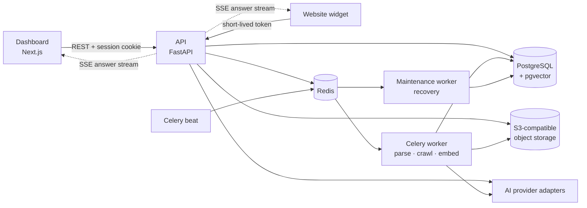

# Multi-Tenant AI Customer Support Platform with RAG

[](https://github.com/vranasinghe/Multi-Tenant-AI-Customer-Support-Platform-with-RAG/actions/workflows/ci.yml)

Businesses create support chatbots that answer from their own documents and websites, embed them on
their sites, and review the conversations. Many organizations share one platform; each one's
knowledge and conversations stay separate.

**Portfolio:** [venuja.online](https://venuja.online)

> **Project status.** An undergraduate software engineering portfolio project, validated locally and
> in CI. It is **not deployed to production**, and answer quality with a real AI model has **not**
> been evaluated. See [Limitations](#limitations).

## Contents

[Features](#features) · [Architecture](#architecture) · [Tech stack](#tech-stack) ·
[Getting started](#getting-started) · [Embedding the widget](#embedding-the-widget) ·
[Testing](#testing) · [Security](#security) · [Limitations](#limitations) ·
[Documentation](#documentation)

## Features

| Area | What it does |
|---|---|
| Organizations | Sign-up with email verification, invitations, four roles (owner, admin, agent, viewer), audit log |
| Chatbots | Guided setup, behaviour and appearance settings, activation per chatbot |
| Knowledge | PDF, DOCX and TXT upload and website crawling, processed in the background |
| Retrieval | Vector and keyword search merged by rank; a built-in retrieval tester |
| Chat | Streaming answers with citations limited to sources the model was actually given; fallback when evidence is insufficient |
| Widget | Embeddable chat for any website, with verified origins and anonymous conversation resume |
| Inbox and analytics | Transcripts, resolution and handoff, ratings, metrics and CSV export from stored events |

Billing and messaging channels are not implemented.

## Architecture

A modular monolith: one Python codebase and one database, run as several processes in containers.



**Retrieval pipeline:** upload or crawl → extract → clean → chunk → embed → store → hybrid
retrieval → prompt assembly → generation → citation validation → streamed answer.

## Tech stack

| Layer | Technology |
|---|---|
| Web | Next.js 16 (App Router), React 19, TypeScript, Tailwind CSS 4 |
| Widget | TypeScript loader and iframe, built with Vite |
| API | Python 3.13, FastAPI, SQLAlchemy 2, Alembic, Pydantic |
| Background jobs | Celery, Redis |
| Data | PostgreSQL 18 with pgvector, S3-compatible object storage |
| Tooling | pnpm workspaces, uv, Docker Compose, GitHub Actions |
| Tests | pytest, Vitest, Playwright, Ruff, mypy, ESLint |

## Getting started

### Prerequisites

- Docker Desktop (or Docker Engine with Compose v2)
- Node.js 24 and pnpm 11 (`corepack enable`)
- [uv](https://docs.astral.sh/uv/) 0.13 or later (only for running Python tools on the host)

### Run the stack

Commands are PowerShell; on macOS or Linux use `cp` instead of `Copy-Item`.

```powershell
git clone https://github.com/vranasinghe/Multi-Tenant-AI-Customer-Support-Platform-with-RAG.git
```

```powershell
cd Multi-Tenant-AI-Customer-Support-Platform-with-RAG
```

```powershell
Copy-Item .env.example .env
```

```powershell
pnpm install
```

```powershell
docker compose up -d --build --wait
```

```powershell
pnpm smoke
```

| URL | What you get |
|---|---|
| http://localhost:3000 | Web dashboard |
| http://localhost:8000/docs | API reference (not available in production mode) |
| http://localhost:8025 | Local mail inbox for verification and invitation emails |

### Choose an AI provider

Chat is **disabled** until you pick a provider in `.env`, then recreate the containers.

| `LLM_PROVIDER` | Use |
|---|---|
| `disabled` | Default |
| `demo` | Offline fixture that streams a fixed reply. Not an AI model; refused in production |
| `openai_compatible` | A real model. Set `LLM_BASE_URL`, `LLM_API_KEY` and the model settings |

Embeddings default to `EMBEDDING_PROVIDER=hash`, an offline stand-in that only matches words. Use
`openai_compatible` for semantic retrieval. Real providers may charge you.
[docs/CHAT_ENGINE.md](docs/CHAT_ENGINE.md) has the full setup. Never commit `.env`.

## Embedding the widget

Activate a chatbot, verify your website's origin in the dashboard, then add the script it gives you
before the closing `</body>` tag:

```html
<script async src="https://YOUR-API-HOST/widget/v1/loader.js" data-bot-key="YOUR_PUBLIC_KEY"></script>
```

See [docs/WIDGET_DEPLOYMENT.md](docs/WIDGET_DEPLOYMENT.md).

## Common commands

| Command | Purpose |
|---|---|
| `pnpm check` | Formatting, lint, type checks and unit tests (TypeScript and Python) |
| `pnpm dev:web` | Dashboard with hot reload against the Dockerized API |
| `pnpm db:migrate` | Apply database migrations |
| `pnpm smoke` | Check every hop of the running stack |
| `pnpm api:test` | Python unit tests |
| `pnpm api:test:integration` | Integration tests (needs PostgreSQL and Redis) |

## Testing

Results from the final local validation run:

| Suite | Passed |
|---|---|
| Backend | 1,209 |
| Runtime proxy (run separately) | 17 |
| Web unit | 243 |
| Widget unit | 19 |
| Browser journeys | 17 |
| **Total** | **1,505** |

A test count is not a coverage figure. CI runs on every pull request with offline providers.

**Measured locally** (one laptop, offline provider, not production capacity):

- 100 concurrent chat requests: 67 served, 33 refused in a controlled way, 0 unexpected failures.
- Offline retrieval Recall@5 of 85% with stand-in embeddings, below the 90% target.
- Compressed widget loader: 5,248 bytes of a 10,240-byte budget.

## Security

- Server-side sessions; the browser holds an opaque identifier in an HttpOnly cookie.
- Role checks on every organization route, with PostgreSQL forced row-level security underneath.
- Short-lived widget tokens and minimal public responses.
- HTTPS required for AI providers; forwarding headers trusted only from listed proxies.
- Documents parsed in a separate process with time and memory limits.

These controls are tested, **not independently audited or certified**.

## Limitations

- No evaluation with a real AI model; answer correctness is unverified.
- A citation shows which source the model was given, not that it supports the sentence.
- Not deployed to production; monitoring, alerting and off-site backup are not in place.
- Document parsing is contained but not sandboxed.
- Approval of the database migration recovery policy is pending.

## Project structure

```text
├── apps/
│   ├── web/             # Next.js dashboard
│   └── widget/          # Embeddable chat widget
├── services/api/        # FastAPI app, Celery tasks, migrations, tests
├── packages/
│   ├── ui/              # Shared UI components
│   └── shared-types/    # Shared TypeScript types
├── infrastructure/      # Database initialization
├── deploy/              # Deployment, backup and restore scripts
├── scripts/             # Smoke test and CI helpers
├── docs/                # Design and operations documents
└── docker-compose.yml   # Local stack
```

## Documentation

| Topic | Documents |
|---|---|
| Design | [Requirements](docs/PRD.md) · [Architecture](docs/ARCHITECTURE.md) · [Database](docs/DATABASE.md) · [API](docs/API_SPEC.md) · [Decisions](docs/DECISIONS.md) |
| Behaviour | [Chat engine](docs/CHAT_ENGINE.md) · [Ingestion](docs/INGESTION.md) · [Widget](docs/WIDGET_DEPLOYMENT.md) · [Retrieval evaluation](docs/RAG_EVALUATION.md) |
| Operations | [Development](docs/DEVELOPMENT.md) · [Deployment](docs/DEPLOY_CONTABO.md) · [Security](docs/SECURITY.md) · [Roadmap](docs/ROADMAP.md) |

Some design documents describe planned behaviour that is not built yet.

## About

Built as an undergraduate portfolio project, developed with AI coding assistants. The work followed
written requirements, explicit acceptance criteria, baseline measurements, focused fixes and
documented validation.

No licence has been chosen yet, so the code is not licensed for reuse.
