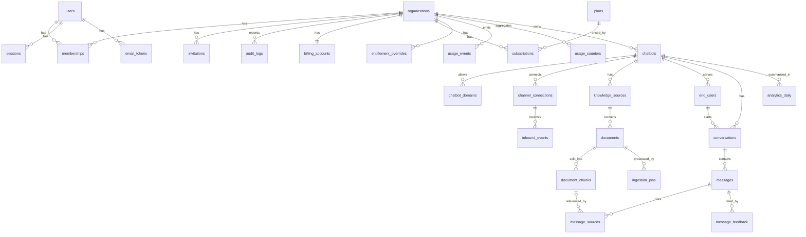

# Database Design

> Phase 5 implemented schema: migration `0005` adds FORCE-RLS-protected `conversations`, `messages` (citation snapshots and feedback), `widget_sessions` (hashed bearer credentials), and `chat_usage` (monthly durable reservations). Phase 7 migration `0007` adds conversation status, CSAT, handoff, `conversation_events`, `unanswered_questions`, `analytics_daily`, and `conversation_exports` (FORCE RLS, `org_id` on every row). Metric definitions: [analytics-metrics.md](analytics-metrics.md). Composite tenant foreign keys prevent cross-tenant relationships. See [CHAT_ENGINE.md](CHAT_ENGINE.md) for the shipped schema and lifecycle; the more extensive tables below remain the target design.

| Field | Value |
|---|---|
| Status | Draft v0.1 — for review |
| Date | 2026-11-21 |
| Engine | PostgreSQL 16+ with `pgvector` ≥ 0.8, `citext`, `pg_trgm`, `pgcrypto` |
| Related | [ARCHITECTURE](ARCHITECTURE.md) · [SECURITY](SECURITY.md) · [DECISIONS](DECISIONS.md) |

---

## 1. Conventions

| Topic | Convention | Why |
|---|---|---|
| Primary keys | `id uuid` **UUIDv7**, generated in the application (`uuid_utils`); `DEFAULT uuidv7()` once on PG 18 | Time-ordered → good index locality; not enumerable; safe to expose (ADR-006) |
| Tenant column | Every tenant-owned table has `org_id uuid NOT NULL` | RLS, composite FKs, query plans |
| Composite uniqueness | Tenant parents declare `UNIQUE (org_id, id)`; children reference `(org_id, parent_id)` | **The DB itself makes cross-tenant references impossible** |
| Timestamps | `created_at timestamptz NOT NULL DEFAULT now()`, `updated_at timestamptz` maintained by trigger | — |
| Soft delete | `deleted_at timestamptz` only on `organizations`, `chatbots`, `knowledge_sources`, `documents`; purged by jobs | Undo window + safe async cleanup; everything else hard-deletes |
| Enumerations | `text` + `CHECK (col IN (...))` | Easier migrations than PG `ENUM` |
| Money | Not stored except Stripe ids & plan display amounts (`integer` minor units) | Stripe is the money system of record |
| JSON | `jsonb` only for genuinely schemaless/config data, always validated by a Pydantic model on write | Avoids hidden schema |
| Naming | snake_case, plural tables, `fk_<table>_<col>`, `ix_<table>_<cols>`, `uq_<table>_<cols>` | Alembic autogenerate consistency |
| Secrets | `bytea` ciphertext + `*_key_id text` (envelope encryption, SECURITY §9); tokens stored as SHA-256 hashes | No plaintext secrets at rest |

---

## 2. Entity relationship model



**Global (non-tenant) tables:** `users`, `sessions`, `email_tokens`, `plans`, `billing_events`, `idempotency_keys` (scoped by user/org in columns), `outbox_events`.

**Tenant tables (RLS-enforced):** everything else.

---

## 3. Table definitions

Types shortened: `uuid`, `text`, `int`, `bigint`, `bool`, `ts` = `timestamptz`, `jsonb`. "FK→" means foreign key (composite with `org_id` where marked ⓒ).

### 3.1 Identity (global)

**users**
| Column | Type | Constraints / notes |
|---|---|---|
| id | uuid | PK |
| email | citext | `UNIQUE`, NOT NULL |
| email_verified_at | ts | null until verified |
| password_hash | text | Argon2id PHC string; nullable for future OAuth-only users |
| name | text | NOT NULL, ≤ 120 |
| locale | text | default `'en'` |
| status | text | `active \| disabled` |
| last_login_at | ts | |
| created_at, updated_at | ts | |

**sessions**
| Column | Type | Constraints / notes |
|---|---|---|
| id | uuid | PK |
| user_id | uuid | FK→users ON DELETE CASCADE |
| token_hash | bytea | `UNIQUE` (SHA-256 of the cookie value) |
| created_at | ts | |
| last_seen_at | ts | sliding idle expiry |
| expires_at | ts | absolute expiry |
| revoked_at | ts | |
| user_agent | text | truncated 256 |
| ip_prefix | inet | /24 (v4) or /48 (v6) — coarse, for "active sessions" UI |
Indexes: `ix_sessions_user_id`, partial `WHERE revoked_at IS NULL`.

**email_tokens**
| Column | Type | Notes |
|---|---|---|
| id | uuid | PK |
| user_id | uuid | FK→users CASCADE |
| purpose | text | `verify_email \| reset_password \| change_email` |
| token_hash | bytea | UNIQUE |
| new_email | citext | for `change_email` |
| expires_at, consumed_at, created_at | ts | |

### 3.2 Tenancy

**organizations**
| Column | Type | Notes |
|---|---|---|
| id | uuid | PK |
| name | text | ≤ 120 |
| slug | citext | UNIQUE, URL-friendly (display only; API uses id) |
| status | text | `active \| restricted \| suspended \| pending_deletion` |
| settings | jsonb | `{conversation_retention_days, default_language, ...}` (Pydantic `OrgSettings`) |
| created_by | uuid | FK→users SET NULL |
| deletion_requested_at | ts | grace period start |
| created_at, updated_at, deleted_at | ts | |
RLS: visible if `id = current_org` **or** user is a member (for org switcher). `UNIQUE (id)` acts as the `(org_id, id)` target for children via `org_id = id`.

**memberships**
| Column | Type | Notes |
|---|---|---|
| id | uuid | PK |
| org_id | uuid | FK→organizations CASCADE |
| user_id | uuid | FK→users CASCADE |
| role | text | `owner \| admin \| agent \| viewer` |
| created_at, updated_at | ts | |
`UNIQUE (org_id, user_id)`; `ix_memberships_user_id`. Invariant "≥ 1 owner" is enforced in the service layer under `SELECT … FOR UPDATE` of the org's owner memberships, plus a deferred constraint trigger as a safety net.

**invitations**
| Column | Type | Notes |
|---|---|---|
| id | uuid | PK |
| org_id | uuid | FK→organizations CASCADE |
| email | citext | invited address (binding) |
| role | text | `admin \| agent \| viewer` (owner via transfer only; enforced by CHECK) |
| token_hash | bytea | UNIQUE |
| invited_by | uuid | FK→users SET NULL |
| expires_at, accepted_at, revoked_at, created_at | ts | |
`UNIQUE (org_id, email) WHERE accepted_at IS NULL AND revoked_at IS NULL`.

**audit_logs** (append-only)
| Column | Type | Notes |
|---|---|---|
| id | uuid | PK |
| org_id | uuid | FK→organizations (no cascade; purged by org purge job) |
| actor_type | text | `user \| system \| api_key \| platform_staff` |
| actor_id | uuid | nullable |
| action | text | e.g. `member.role_changed`, `chatbot.deleted`, `channel.connected`, `billing.plan_changed` |
| target_type, target_id | text, uuid | |
| metadata | jsonb | before/after diffs (no secrets) |
| ip_prefix | inet | |
| request_id | text | |
| created_at | ts | |
`ix_audit_logs_org_created (org_id, created_at DESC)`. `REVOKE UPDATE, DELETE` from `platform_app`.

### 3.3 Chatbots & channels

**chatbots**
| Column | Type | Notes |
|---|---|---|
| id | uuid | PK; `UNIQUE (org_id, id)` |
| org_id | uuid | FK→organizations |
| name | text | ≤ 80 |
| description | text | |
| status | text | `draft \| active \| paused \| archived` |
| public_key | text | UNIQUE, `pk_live_` + 24 random base62 chars (rotatable) |
| instructions | text | ≤ 4,000 chars |
| tone | text | `professional \| friendly \| concise \| custom` |
| welcome_message, fallback_message, escalation_message | text | |
| language_mode | text | `auto \| fixed`; `language` text (BCP-47) when fixed |
| model | text | must be in model registry allowlist (validated in app) |
| temperature | numeric(3,2) | default 0.20, CHECK 0–1 |
| strict_grounding | bool | default true |
| retrieval_top_k | int | default 6, CHECK 1–12 |
| similarity_threshold | numeric(4,3) | default per embedding model |
| widget_settings | jsonb | `{primary_color, title, avatar_url, position, launcher_label, show_branding}` |
| test_mode_until | ts | allows localhost origins until this time |
| embedding_model | text | model used for this bot's chunks (ADR-012) |
| created_by | uuid | FK→users SET NULL |
| created_at, updated_at, deleted_at | ts | |
Indexes: `ix_chatbots_org (org_id) WHERE deleted_at IS NULL`.

**chatbot_domains**
| Column | Type | Notes |
|---|---|---|
| id | uuid | PK |
| org_id, chatbot_id | uuid | FK ⓒ→chatbots CASCADE |
| domain | text | normalized host (punycode, lowercase); `*.` prefix allowed for wildcard |
| verification_method | text | `meta_tag \| dns_txt` |
| verification_token | text | random 32 chars |
| status | text | `pending \| verified \| failing \| unverified` |
| verified_at, last_checked_at | ts | |
| consecutive_failures | int | |
`UNIQUE (chatbot_id, domain)`. CHECK: wildcard requires `dns_txt`.

**channel_connections**
| Column | Type | Notes |
|---|---|---|
| id | uuid | PK (also used in webhook URL path) |
| org_id, chatbot_id | uuid | FK ⓒ→chatbots CASCADE |
| type | text | `telegram \| whatsapp` |
| status | text | `pending \| active \| error \| disconnected` |
| external_account_id | text | Telegram bot id / WhatsApp `phone_number_id` |
| display_name | text | `@bot_username` / phone display |
| credentials_ciphertext | bytea | encrypted JSON (bot token / access token / app secret) |
| credentials_key_id | text | encryption key version |
| webhook_secret_hash | bytea | Telegram secret token hash / WhatsApp verify token hash |
| config | jsonb | channel-specific options |
| last_event_at | ts | |
| last_error_code, last_error_at | text, ts | |
| created_by | uuid | |
| created_at, updated_at | ts | |
`UNIQUE (type, external_account_id) WHERE status <> 'disconnected'` — a bot/number can serve only one chatbot at a time.

**inbound_events** (webhook idempotency)
| Column | Type | Notes |
|---|---|---|
| id | uuid | PK |
| org_id | uuid | |
| connection_id | uuid | FK→channel_connections CASCADE |
| provider | text | `telegram \| whatsapp` |
| external_event_id | text | `update_id` / `wamid` |
| status | text | `received \| processed \| ignored \| failed` |
| received_at, processed_at | ts | |
| error_code | text | |
`UNIQUE (provider, connection_id, external_event_id)`. Payloads are **not** stored (PII); kept 7 days then purged.

### 3.4 Knowledge

> **As implemented (migration `0004`)** — differences from the tables below: `knowledge_sources`, `documents` and `ingestion_jobs` have **no `deleted_at`**: deleting a document/source hard-deletes it, its chunks (vectors) and jobs in one transaction, and queues the stored original for removal in the new outbox table `storage_deletions` (so a crash cannot orphan a file). `documents` also has `file_hash` (SHA-256 of the upload; unique per chatbot → duplicate uploads are rejected by the database), `embedding_model`, and no `language`; `document_chunks` has `embedding_model` and a `vector(1536)` + HNSW index, `fts` uses the `simple` config; `ingestion_jobs.kind` is `process_document | crawl`. Cross-tenant job/outbox discovery for the sweeper uses `app.list_stuck_jobs()` and `app.list_pending_storage_deletions()` (SECURITY DEFINER). See [INGESTION.md](INGESTION.md).

**knowledge_sources**
| Column | Type | Notes |
|---|---|---|
| id | uuid | PK; `UNIQUE (org_id, id)` |
| org_id, chatbot_id | uuid | FK ⓒ→chatbots |
| kind | text | `file \| website \| text` |
| name | text | |
| status | text | `pending \| syncing \| ready \| partial \| failed` (derived from documents) |
| config | jsonb | website: `{start_url, sitemap_url, include[], exclude[], max_pages, max_depth}` |
| stats | jsonb | `{documents, ready, failed, chunks, bytes}` (denormalized, updated by jobs) |
| last_synced_at | ts | |
| created_by | uuid | |
| created_at, updated_at, deleted_at | ts | |

**documents**
| Column | Type | Notes |
|---|---|---|
| id | uuid | PK; `UNIQUE (org_id, id)` |
| org_id, chatbot_id | uuid | denormalized for filtering; FK ⓒ→chatbots |
| source_id | uuid | FK ⓒ→knowledge_sources CASCADE |
| title | text | |
| uri | text | filename or canonical URL |
| storage_key | text | `orgs/{org}/chatbots/{bot}/documents/{doc}/v{n}/original` |
| mime_type | text | sniffed |
| size_bytes | bigint | |
| content_hash | bytea | SHA-256 of normalized text (dedupe & change detection) |
| http_etag, http_last_modified | text | website re-sync |
| version | int | increments on replace/re-sync with changes |
| status | text | `pending \| queued \| processing \| ready \| failed` |
| error_code, error_message | text | user-safe message |
| page_count, token_count, chunk_count | int | |
| language | text | detected |
| created_at, updated_at, deleted_at | ts | |
Indexes: `(source_id)`, `(chatbot_id, status)`, `UNIQUE (source_id, uri) WHERE deleted_at IS NULL`.

**document_chunks**
| Column | Type | Notes |
|---|---|---|
| id | uuid | PK |
| org_id, chatbot_id | uuid | denormalized; FK ⓒ→chatbots |
| document_id | uuid | FK ⓒ→documents CASCADE |
| document_version | int | must equal `documents.version` to be served |
| ordinal | int | position in doc |
| content | text | chunk text shown in citations |
| embedded_text | text | NULL if identical to content; else content with context header |
| token_count | int | |
| heading_path | text[] | e.g. `{Returns, International}` |
| page_start, page_end | int | |
| embedding | vector(1536) | ADR-012 (or `halfvec(1536)` — Q-17) |
| fts | tsvector | `GENERATED ALWAYS AS (to_tsvector(fts_config, content)) STORED` — `fts_config regconfig` column per chatbot language, default `'simple'` |
| metadata | jsonb | url anchor, table flag, etc. |
| created_at | ts | |
Indexes:
- `ix_chunks_embedding_hnsw USING hnsw (embedding vector_cosine_ops) WITH (m = 16, ef_construction = 64)`
- `ix_chunks_fts USING gin (fts)`
- `ix_chunks_chatbot (chatbot_id)` and `ix_chunks_document (document_id, document_version)`

**ingestion_jobs**
| Column | Type | Notes |
|---|---|---|
| id | uuid | PK |
| org_id | uuid | |
| chatbot_id | uuid | |
| document_id | uuid | nullable (crawl planning jobs target a source) |
| source_id | uuid | |
| kind | text | `process_document \| plan_crawl \| fetch_page \| reindex` |
| status | text | `queued \| processing \| succeeded \| failed \| canceled` |
| stage | text | `validate \| extract \| chunk \| embed \| persist` |
| attempt, max_attempts | int | default 0 / 3 |
| celery_task_id | text | |
| queued_at, started_at, finished_at, heartbeat_at | ts | sweeper uses `heartbeat_at` |
| error_code, error_detail | text | `error_detail` internal only |
| stats | jsonb | timings, tokens |
Indexes: `(status, queued_at)` for sweeper, `(document_id)`.

### 3.5 Conversations

**end_users**
| Column | Type | Notes |
|---|---|---|
| id | uuid | PK; `UNIQUE (org_id, id)` |
| org_id, chatbot_id | uuid | FK ⓒ→chatbots CASCADE |
| channel | text | `widget \| telegram \| whatsapp \| playground` |
| external_id_hash | bytea | HMAC-SHA256(platform_pepper, channel‖raw id) — visitor uuid / Telegram user id / phone |
| external_id_ciphertext | bytea | only when needed to reply (Telegram chat id, WhatsApp phone) |
| display_name | text | optional (Telegram first name) |
| locale | text | |
| first_seen_at, last_seen_at | ts | |
`UNIQUE (chatbot_id, channel, external_id_hash)`.

**conversations**
| Column | Type | Notes |
|---|---|---|
| id | uuid | PK; `UNIQUE (org_id, id)` |
| org_id, chatbot_id | uuid | FK ⓒ→chatbots |
| end_user_id | uuid | FK ⓒ→end_users CASCADE |
| channel | text | as above |
| channel_connection_id | uuid | nullable |
| status | text | `open \| closed` (`handoff` post-MVP) |
| origin_host | text | widget parent host (no path/query) |
| message_count | int | |
| has_negative_feedback, has_ungrounded | bool | list filters |
| started_at, last_message_at | ts | |
| title | text | first user question truncated (P1: LLM summary) |
Indexes: `(chatbot_id, last_message_at DESC)`, `(org_id, last_message_at DESC)`, partial `WHERE has_negative_feedback`, partial `WHERE has_ungrounded`.

**messages**
| Column | Type | Notes |
|---|---|---|
| id | uuid | PK; `UNIQUE (org_id, id)` |
| org_id, chatbot_id | uuid | denormalized |
| conversation_id | uuid | FK ⓒ→conversations CASCADE |
| role | text | `user \| assistant` |
| content | text | |
| status | text | `complete \| failed \| blocked \| quota_exceeded` |
| grounded | bool | assistant only |
| model | text | |
| prompt_version | text | |
| prompt_tokens, completion_tokens | int | sum incl. rewrite call |
| cost_microusd | bigint | computed from model registry |
| latency_first_token_ms, latency_total_ms | int | |
| retrieval | jsonb | `{rewritten_query, top_score, candidates:[{chunk_id, score, leg}]}` — agents and above only |
| external_message_id | text | channel message id |
| error_code | text | |
| created_at | ts | |
Indexes: `(conversation_id, created_at)`, `(chatbot_id, created_at) WHERE role='user' AND grounded IS FALSE` (unanswered questions; `grounded` mirrored onto the user message after reply), GIN `to_tsvector('simple', content)` (P1 search).

**message_sources** (citations snapshot)
| Column | Type | Notes |
|---|---|---|
| message_id | uuid | FK ⓒ→messages CASCADE |
| rank | int | citation number `[n]` |
| org_id | uuid | |
| chunk_id | uuid | FK→document_chunks **ON DELETE SET NULL** |
| document_id | uuid | FK→documents ON DELETE SET NULL |
| title, uri | text | snapshot so citations survive reindex/deletion |
| page | int | |
| score | real | |
| cited | bool | whether the answer actually referenced `[n]` |
PK `(message_id, rank)`.

**message_feedback**
| Column | Type | Notes |
|---|---|---|
| id | uuid | PK |
| org_id | uuid | |
| message_id | uuid | FK ⓒ→messages CASCADE |
| end_user_id | uuid | nullable (dashboard reviewers use `reviewer_user_id`) |
| reviewer_user_id | uuid | internal review (P1) |
| rating | smallint | `1` (up) / `-1` (down) |
| reason | text | `incorrect \| outdated \| unhelpful \| other` |
| comment | text | ≤ 1,000 |
| created_at | ts | |
`UNIQUE (message_id, end_user_id)`.

### 3.6 Billing & usage

**plans** (global, seeded via migration/data script)
| Column | Type | Notes |
|---|---|---|
| id | uuid | PK |
| code | text | UNIQUE e.g. `starter_monthly_v1` |
| name | text | |
| tier | text | `trial \| starter \| growth \| business` |
| interval | text | `month \| year \| none` |
| stripe_price_id | text | UNIQUE nullable (trial has none) |
| display_amount_minor, currency | int, text | for UI only |
| limits | jsonb | `PlanLimits` schema (see PRD §10) |
| is_public, is_active | bool | |
| version | int | plans are versioned; old versions grandfathered |

**billing_accounts**
| Column | Type | Notes |
|---|---|---|
| org_id | uuid | PK, FK→organizations |
| stripe_customer_id | text | UNIQUE |
| billing_email | citext | |
| created_at, updated_at | ts | |

**subscriptions**
| Column | Type | Notes |
|---|---|---|
| id | uuid | PK |
| org_id | uuid | FK |
| plan_id | uuid | FK→plans |
| stripe_subscription_id | text | UNIQUE nullable (trial) |
| status | text | `trialing \| active \| past_due \| restricted \| canceled \| expired \| incomplete` |
| current_period_start, current_period_end | ts | |
| trial_end, cancel_at, canceled_at, grace_until | ts | |
| cancel_at_period_end | bool | |
| updated_from_stripe_at | ts | ordering guard |
`UNIQUE (org_id) WHERE status IN ('trialing','active','past_due','restricted','incomplete')` — one live subscription per org.

**billing_events** (global; Stripe webhook inbox)
| Column | Type | Notes |
|---|---|---|
| stripe_event_id | text | PK |
| type | text | |
| org_id | uuid | resolved, nullable |
| payload | jsonb | retained 90 days |
| received_at, processed_at | ts | |
| status, error | text | |

**entitlement_overrides**
| Column | Type | Notes |
|---|---|---|
| id | uuid | PK |
| org_id | uuid | |
| key | text | e.g. `message_credits` |
| value | jsonb | |
| reason | text | required |
| granted_by | text | staff identifier |
| expires_at, created_at | ts | |

**usage_events** — append-only, **range-partitioned by `occurred_at` (monthly) from day one**
| Column | Type | Notes |
|---|---|---|
| id | uuid | |
| org_id | uuid | |
| chatbot_id | uuid | nullable |
| metric | text | `message_credits \| llm_input_tokens \| llm_output_tokens \| embedding_tokens \| storage_bytes_delta \| indexed_pages_delta` |
| quantity | bigint | may be negative for gauge deltas |
| occurred_at | ts | partition key |
| idempotency_key | text | e.g. `msg:{message_id}:credits` |
| ref_type, ref_id | text, uuid | |
PK `(occurred_at, id)`; `UNIQUE (idempotency_key, occurred_at)`; index `(org_id, metric, occurred_at)`. Partitions are created 3 months ahead by a beat task. Retained 25 months.

**usage_counters**
| Column | Type | Notes |
|---|---|---|
| org_id | uuid | |
| metric | text | |
| period_start | ts | |
| period_end | ts | |
| value | bigint | |
| updated_at | ts | |
PK `(org_id, metric, period_start)`. Gauges (`storage_bytes`, `indexed_pages`, `active_chatbots`, `members`) use a sentinel `period_start = '-infinity'`.

### 3.7 Analytics

**analytics_daily**
| Column | Type | Notes |
|---|---|---|
| org_id, chatbot_id | uuid | |
| day | date | in UTC (tz display handled in UI; per-org tz rollups post-MVP) |
| channel | text | |
| conversations, messages_user, messages_assistant | int | |
| grounded_answers, ungrounded_answers | int | |
| feedback_up, feedback_down | int | |
| latency_first_token_p50_ms, latency_first_token_p95_ms | int | |
| prompt_tokens, completion_tokens | bigint | |
| cost_microusd | bigint | internal only |
PK `(chatbot_id, day, channel)`; index `(org_id, day)`. Rebuilt incrementally (hourly for today, final at 02:00 UTC for yesterday). Idempotent `INSERT … ON CONFLICT DO UPDATE` from source tables.

### 3.8 Platform

**idempotency_keys**
| Column | Type | Notes |
|---|---|---|
| key | text | client-supplied `Idempotency-Key` |
| scope | text | `org:{id}` or `user:{id}` |
| request_hash | bytea | method+path+body hash |
| response_status | int | |
| response_body | jsonb | |
| created_at, expires_at | ts | 24 h |
PK `(scope, key)`.

**outbox_events** (used narrowly — ADR-007)
| Column | Type | Notes |
|---|---|---|
| id | uuid | PK |
| org_id | uuid | nullable |
| topic | text | e.g. `billing.quota_threshold_reached` |
| payload | jsonb | |
| created_at, dispatched_at | ts | |
| attempts | int | |
Partial index `WHERE dispatched_at IS NULL`.

---

## 4. Tenant isolation in the database

### 4.1 Database roles

| Role | Login | RLS | Used by | Privileges |
|---|---|---|---|---|
| `platform_owner` | migration job only | n/a (owner) | Alembic | DDL; owns all objects |
| `platform_app` | api, worker | **enforced** (`NOBYPASSRLS`) | All request & tenant-task code | DML on app tables; no DDL; no UPDATE/DELETE on `audit_logs`; EXECUTE on resolver functions |
| `platform_system` | worker (system tasks), CLI | `BYPASSRLS` | Billing webhooks, rollups, sweepers, purges, admin CLI | DML; every session logs `application_name='system:<task>'` |
| `platform_readonly` | analysts (optional) | enforced, no GUC → sees only global tables | BI on aggregates | SELECT on views |

`FORCE ROW LEVEL SECURITY` is set on every tenant table so even the table owner is subject to policies outside migrations.

### 4.2 Policies

```sql
-- Helper (STABLE, returns NULL if unset → policies match nothing)
CREATE FUNCTION app.current_org_id() RETURNS uuid
  LANGUAGE sql STABLE AS $$ SELECT nullif(current_setting('app.current_org_id', true), '')::uuid $$;
CREATE FUNCTION app.current_user_id() RETURNS uuid
  LANGUAGE sql STABLE AS $$ SELECT nullif(current_setting('app.current_user_id', true), '')::uuid $$;

-- Standard policy, applied to every tenant table by a migration helper:
ALTER TABLE chatbots ENABLE ROW LEVEL SECURITY;
ALTER TABLE chatbots FORCE ROW LEVEL SECURITY;
CREATE POLICY tenant_isolation ON chatbots
  USING (org_id = app.current_org_id())
  WITH CHECK (org_id = app.current_org_id());

-- memberships: visible within current org OR the user's own memberships (org switcher)
CREATE POLICY membership_visibility ON memberships
  USING (org_id = app.current_org_id() OR user_id = app.current_user_id())
  WITH CHECK (org_id = app.current_org_id());
```

### 4.3 Pre-tenant lookups (resolver functions)

Some requests must find the tenant *before* an org context exists. These go through narrow `SECURITY DEFINER` functions owned by `platform_system`. They return the minimum columns and are the **only** cross-tenant read paths available to `platform_app`:

| Function | Input | Returns | Caller |
|---|---|---|---|
| `app.resolve_public_key(pk text)` | widget public key | `chatbot_id, org_id, status` | widget session endpoint, embed shell |
| `app.resolve_channel_connection(id uuid)` | connection id from webhook URL | `connection_id, org_id, chatbot_id, type, status` | Telegram/WhatsApp webhooks |
| `app.resolve_whatsapp_number(phone_number_id text)` | Meta phone number id | same as above | WhatsApp shared webhook |
| `app.resolve_invitation(token_hash bytea)` | invite token hash | `invitation_id, org_id, email, role, expires_at` | accept-invite flow |

After resolution, the API sets `app.current_org_id` and continues under normal RLS.

### 4.4 Isolation tests (mandatory in CI)

1. For each tenant table: as `platform_app` without GUCs, `SELECT count(*)` returns 0.
2. With GUC = org A, inserting a row with `org_id = B` fails (`WITH CHECK`).
3. Composite FK: inserting a `document` with `org_id = A` referencing a chatbot of org B fails.
4. Vector search with org A context never returns org B chunks, even with an identical embedding (seeded collision test).
5. Migration lint: any new table with an `org_id` column but no RLS policy fails CI (`scripts/check_rls.py` queries `pg_policies`).

---

## 5. Vector search strategy

**Query shape (vector leg):**
```sql
SET LOCAL hnsw.ef_search = 80;
SET LOCAL hnsw.iterative_scan = relaxed_order;   -- pgvector >= 0.8: keeps scanning until LIMIT satisfied after filtering
SELECT c.id, c.document_id, c.content, 1 - (c.embedding <=> :q) AS score
FROM document_chunks c
JOIN documents d ON d.id = c.document_id AND d.version = c.document_version
WHERE c.chatbot_id = :chatbot_id            -- RLS adds org_id = current org
  AND d.status = 'ready' AND d.deleted_at IS NULL
ORDER BY c.embedding <=> :q
LIMIT 30;
```

**Filtered-ANN considerations:** one global HNSW index with a selective `chatbot_id` filter can lose recall, because the index returns nearest neighbours across all tenants and then filters. Mitigations, in order:
1. **Iterative index scans** (pgvector 0.8+). This is the default.
2. For small chatbots (< ~20k chunks), an **exact scan** using the btree on `chatbot_id` is fast enough (< 20 ms) and has perfect recall. The retriever picks exact vs ANN based on `chatbots.chunk_count` (cached).
3. At scale: **hash-partition `document_chunks` by `chatbot_id`** (e.g. 64 partitions) with per-partition HNSW, or per-large-tenant partial indexes.

**Embedding model changes (ADR-012):** `chatbots.embedding_model` records which model produced its chunks. Switching models is a background `reindex` job that writes into a shadow column/table for that chatbot and swaps atomically. The vector column type has a fixed dimension, so a model with a different dimension requires a migration adding a new column (or truncation via Matryoshka-capable models to 1536).

---

## 6. Data lifecycle & retention

| Data | Default retention | Mechanism |
|---|---|---|
| Conversations & messages | Plan-based (30 d trial … 2 y), org-configurable downward | Daily purge job deletes conversations where `last_message_at < now() - retention`; cascades to messages, sources, feedback |
| Analytics rollups | Kept while org exists (aggregates, no content) | — |
| Documents/chunks/files | Until deleted by user | Soft delete → immediately excluded from retrieval → hard delete + S3 delete within 24 h |
| Inbound webhook events | 7 days | Daily purge |
| Billing events payloads | 90 days | Daily purge (rows kept, payload nulled) |
| Usage events | 25 months | Drop old partitions |
| Audit logs | 1 year (2 years Business) | Monthly purge |
| Sessions / email tokens | 30 days after expiry | Daily purge |
| Deleted org | 30-day grace → full purge (DB rows, S3 prefix `orgs/{id}/`, Redis keys, Stripe cancel) | `org_purge` job, logged in a platform-level purge ledger (no tenant content) |
| Backups | PITR 14 days; deleted data ages out of backups within 35 days | Documented in privacy policy |

---

## 7. Migrations & schema evolution

- Alembic, one linear history (`alembic heads` must be 1 in CI).
- Every migration ships with `upgrade` and `downgrade` and is reviewed for lock impact. Use `CREATE INDEX CONCURRENTLY` (in autocommit blocks) for large tables, add columns nullable first, and backfill in batches via a task.
- A migration helper `enable_tenant_rls(table)` applies `ENABLE/FORCE RLS` + the standard policy so it is never forgotten.
- Seed data: `plans` via data migration; dev fixtures via `pnpm db:seed` (Python script) creating 2 orgs (for isolation testing), users per role, a chatbot with a small corpus.
- Postgres init (`infra/postgres/init.sql`): `CREATE EXTENSION vector, citext, pg_trgm, pgcrypto;` and role creation.

---

## 8. Storage layout (S3)

```
s3://{bucket}/orgs/{org_id}/chatbots/{chatbot_id}/documents/{document_id}/v{version}/original
s3://{bucket}/orgs/{org_id}/chatbots/{chatbot_id}/documents/{document_id}/v{version}/extracted.md
s3://{bucket}/orgs/{org_id}/exports/{export_id}.csv          (expires after 7 days via lifecycle rule)
s3://{bucket}/tmp/uploads/...                                 (abandoned presigned uploads, 24 h lifecycle)
```
Private bucket, Block Public Access, SSE (S3-managed or KMS), versioning off (deletes must be real), and lifecycle rules for `tmp/` and `exports/`. Access is only through the API (presigned URLs, 10-minute expiry, bound content-type and content-length).
