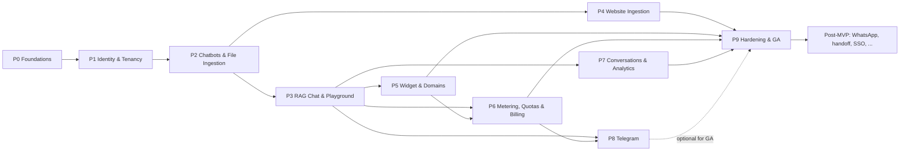

# Implementation Roadmap

| Field | Value |
|---|---|
| Status | Draft v0.1 — for review |
| Date | 2026-11-21 |
| Team assumption | 2–4 engineers (A7). Estimates are **ideal engineer-weeks** for planning order, not commitments |
| Related | [PRD](PRD.md) · [ARCHITECTURE](ARCHITECTURE.md) · [API_SPEC](API_SPEC.md) · [DECISIONS](DECISIONS.md) |

---

## 1. Phase overview & dependencies

| Phase | Name | Depends on | Est. (eng-weeks) | Can run in parallel with |
|---|---|---|---|---|
| P0 | Foundations & developer workflow | — | 3 | — |
| P1 | Identity, tenancy & RBAC | P0 | 4 | Widget loader spike (P5 prep) |
| P2 | Chatbots & file ingestion | P1 | 4 | — |
| P3 | RAG chat, playground & eval harness | P2 | 5 | P4 |
| P4 | Website ingestion | P2 (pipeline), SafeFetcher | 3 | P3 |
| P5 | Embeddable widget & domain verification | P3 | 4 | P4, P7 |
| P6 | Metering, quotas & billing | P3 (usage events), P5 (public enforcement) | 4 | P7 |
| P7 | Conversations & analytics dashboard | P3 | 3 | P5, P6 |
| P8 | Telegram channel | P3, P6 | 2 | P7 |
| P9 | Hardening, compliance & GA | P4–P7 (P8 if in GA scope) | 4 | — |
| **MVP total** | | | **≈ 36 eng-weeks** (≈ 3–4.5 months with 3 engineers in parallel tracks) | |

**Critical path:** P0 → P1 → P2 → P3 → P5 → P6 → P9.

**Cross-cutting from Phase 0 onward (never "a later phase"):** tenancy tests, OpenAPI contract checks, observability, security review of each PR touching the data layer, docs updated with ADRs.

**External lead-time items (start early):**
| Item | Start by | Why |
|---|---|---|
| Meta Business verification + WhatsApp Tech Provider application | P5 | Weeks of review; blocks post-MVP WhatsApp |
| Stripe account activation, tax settings, product/price setup | P3 | Needed for P6 test mode → live |
| LLM provider org, zero-retention / no-training settings, rate-limit tier | P2 | Rate tier affects load tests |
| Legal: ToS, Privacy Policy, DPA, subprocessor list | P6 | Required for GA |
| Domain names, email sending domain (SPF/DKIM/DMARC) | P0–P1 | Email deliverability warm-up |
| External pen test booking | P7 | Vendor scheduling |

---

## 2. Definition of Done (every phase)

- [ ] All endpoints for the phase exist in OpenAPI and the generated client compiles; contract diff check passes.
- [ ] Unit + integration tests pass; coverage on new backend domain/service code ≥ 80%.
- [ ] Tenancy suite extended for every new org-scoped table and endpoint; RLS check script passes.
- [ ] Permissions declared on every new route; authz matrix test updated.
- [ ] Migrations reversible; single Alembic head.
- [ ] Structured logs + traces on new flows; no PII in logs (log-scrub test).
- [ ] Playwright smoke updated if a user-facing flow was added.
- [ ] Docs/ADRs updated when a decision changed.
- [ ] Deployed to staging and demoed against the phase acceptance criteria.

---

## 3. Phases in detail

### Phase 0 — Foundations & developer workflow (3 wk)

**Goal:** a new engineer runs the whole stack with one command, and CI enforces quality from the first PR.

> **Status (2026-11-21): core delivered, some items deferred.** (The project brief called this "Phase 1: project initialization"; it is Phase 0 here.)
> - **Delivered:** monorepo (`apps/web`, `apps/widget`, `services/api`, `packages/ui`, `packages/shared-types`, `infrastructure/`); Next.js 16 + Tailwind 4 + shadcn/ui; FastAPI with validated settings, structlog JSON/console logs, request-ID middleware, RFC 9457 errors, `/healthz` + `/readyz`; Celery worker with request-ID propagation; Alembic with bootstrap migration (extensions, `app.current_org_id()`/`current_user_id()` RLS helpers); unprivileged runtime DB role; Docker Compose stack; CI (lint, typecheck, unit + integration tests, reversible migrations, builds, Docker stack smoke test); setup guide ([DEVELOPMENT.md](DEVELOPMENT.md)).
> - **AC status:** AC0.1 ✅ (verified on Windows 11 + Docker Desktop) · AC0.2 ✅ partly: lint/type/test/second-head failures block; OpenAPI→client drift check deferred · AC0.3 ⏳ `check_rls` arrives with the first tenant table (Phase 1) · AC0.4 ✅ partly: the runtime role is verified non-superuser/no-BYPASSRLS and the tenant GUC helpers are transaction-scoped; the per-table RLS test needs tables · AC0.5 ✅ partly: request-ID propagation API→worker verified; OpenTelemetry trace linking deferred · AC0.6 ⏳ blocked on hosting decision Q-02.
> - **Deferred to early Phase 1:** OpenAPI → TypeScript client generation + contract check; `import-linter` layers contract; OpenTelemetry + Sentry wiring; `security.yml` (CodeQL, gitleaks, pip-audit, Trivy); pre-commit hooks; MinIO + Mailpit compose services (needed by uploads and email); mock LLM service.

**Scope**
- Monorepo layout per ARCHITECTURE §5; pnpm + Turborepo; `uv` workspace for Python.
- `apps/api`: FastAPI app factory, settings (pydantic-settings), structured logging, request id middleware, problem+json error handler, `/healthz`, `/readyz`; SQLAlchemy async/sync engines; Alembic with `enable_tenant_rls` helper; DB roles bootstrap; Celery app with queues + a demo task; tenant context plumbing (`TenantContext`, GUC setter) with tests.
- `apps/web`: Next.js App Router, Tailwind, shadcn/ui init, layout shell, TanStack Query, generated API client wiring.
- `apps/widget`: Vite build skeleton (loader + Preact app), no features.
- `infra/compose`: postgres (pgvector image), redis, minio (+ bucket init), mailpit, api, worker, beat, web, widget; optional `mock-llm` service (deterministic OpenAI-compatible fake).
- CI workflows: `ci.yml`, `security.yml` per ARCHITECTURE §16.1; branch protection.
- Tooling: Ruff, mypy, import-linter contracts, ESLint/Prettier, pre-commit (gitleaks, ruff, prettier), `scripts/check_rls.py`.
- Observability baseline: OpenTelemetry SDK wired (console exporter locally), Sentry DSN optional.
- Staging environment provisioned (IaC) with deploy workflow (ADR-022 must be confirmed — Q-02).

**API contracts:** `GET /healthz`, `GET /readyz`; OpenAPI exported at build; `packages/api-client` generated.

**Acceptance criteria**
- AC0.1 On a clean Windows 11 machine with Docker Desktop, `pnpm install && pnpm dev` (documented in README) brings up all services; `http://localhost:3000` shows the web shell and `/readyz` returns 200 within 5 minutes of first run.
- AC0.2 A PR that introduces a Ruff error, a type error, a failing test, an OpenAPI/client drift or a second Alembic head is blocked by CI.
- AC0.3 A test creates a table with `org_id` but no RLS policy → `check_rls` fails CI.
- AC0.4 A tenant-context integration test proves: as `platform_app` with no GUC, a tenant table query returns 0 rows; with GUC A it returns only A rows.
- AC0.5 A Celery demo task enqueued after commit runs in the worker and its trace links to the originating request.
- AC0.6 Merge to `main` deploys to staging automatically and runs migrations as a separate step.

**Exit criteria:** CI median < 10 min; staging live; local setup documented and verified by a second engineer.

---

### Phase 1 — Identity, tenancy & RBAC (4 wk)

> **Status (2026-11-22): implemented** (the project brief calls this "Phase 2"). Backend: identity + tenancy modules, migration `0002` with RLS, auth/org/member/invitation/audit APIs, rate limiting, CSRF. Frontend: auth screens, org switcher, members and invitations, account and sessions. Tests: backend unit + integration incl. the tenant-isolation suite and concurrency tests; frontend unit + component tests. Security review and migration steps: [PHASE2_SECURITY_REVIEW.md](PHASE2_SECURITY_REVIEW.md).
> **Not in this phase:** AC1.10 Playwright E2E (the same flow was walked manually in a browser), org deletion/restore, change-email, HIBP breach lookup, OpenAPI client generation, nonce-based CSP. Role `editor` was renamed `agent` (ADR-005 amendment).

**Goal:** users sign up, belong to orgs, invite teammates, and every request is authorized and tenant-scoped.

**Scope:** `identity` and `tenancy` modules; tables `users, sessions, email_tokens, organizations, memberships, invitations, audit_logs`; email sending via provider abstraction (Mailpit locally); dashboard pages for signup, login, verify email, forgot/reset password, org switcher, org settings, members, invitations, accept invite; resolver function `resolve_invitation`; audit logging service.

**API contracts:** API_SPEC §2.1, §2.2 (audit-log list endpoint backend may ship in P7 with UI).

**Acceptance criteria**
- AC1.1 (FR-AUTH-1/2) Signup creates user, org and owner membership in one transaction; the verification email arrives in Mailpit; unverified users get `403 email_not_verified` on `POST /orgs/{id}/chatbots` and invitations.
- AC1.2 (FR-AUTH-3) Session cookie has `__Host-` prefix, HttpOnly, Secure, SameSite=Lax; logout revokes it server-side (reusing the old cookie → 401).
- AC1.3 (FR-AUTH-4) Password reset token works once, expires after 30 min, and revokes all existing sessions.
- AC1.4 (FR-AUTH-5) Login with unknown email vs. wrong password produces identical status, body and timing (within 50 ms p95 in test); the 6th failed attempt in a minute → 429.
- AC1.5 (FR-ORG-2) An invitation to `alice@x.com` cannot be accepted by a session for `bob@x.com` (403); an accepted or expired invitation cannot be reused.
- AC1.6 (FR-ORG-3) Demoting/removing the last owner → `409 last_owner`; an admin cannot modify an owner; an agent calling `PATCH /members/{id}` → 403.
- AC1.7 Cross-tenant: a member of org A requesting any org B endpoint gets 404 (automated across all routes).
- AC1.8 (FR-ORG-6) Role change, removal, invitation create/revoke and ownership transfer each produce one audit log row with actor and target.
- AC1.9 CSRF: a state-changing request without `X-Requested-With`, or with a foreign `Origin`, → 403.
- AC1.10 Playwright: signup → verify (via Mailpit API) → invite → accept as second user → see shared org.

---

### Phase 2 — Chatbots & file ingestion (4 wk)

**Goal:** agents create chatbots and turn uploaded files into searchable, embedded chunks reliably.

> **Status (2026-11-22): file + website ingestion, indexing, retrieval and deletion implemented** (the project brief calls this "Phase 4"; chatbot CRUD and the dashboard shipped in its "Phase 3"). See [INGESTION.md](INGESTION.md) and [RAG_EVALUATION.md](RAG_EVALUATION.md). **Delivered:** PDF/DOCX/TXT upload with signature validation, private S3 storage, extraction/normalization/chunking, batched embeddings into pgvector, vector + keyword + hybrid retrieval, SSRF-safe website crawler, Celery jobs with retries/idempotency/sweeper, reindexing and embedding-model versioning, dashboard knowledge screens, retrieval tester, evaluation harness. **Not delivered:** text/Q&A sources, presigned uploads, document replace/download, OCR, sitemap parsing, per-plan limits (static limits only), parser sandboxing, a real embedding model (local `hash-v1` baseline only; the quality figures in RAG_EVALUATION.md describe that baseline, not a production model). AC2.2's p95 timing was not measured on staging.

**Scope:** `chatbots`, `knowledge`, `llm` (embedding part) modules; tables `chatbots, knowledge_sources, documents, document_chunks, ingestion_jobs`; S3 presigned uploads; extraction (PDF, DOCX, TXT, MD; P1: HTML, CSV); normalization; structure-aware chunker; batched embeddings via the provider abstraction; stuck-job sweeper; text/Q&A sources (P1); dashboard: chatbot list/create/settings, knowledge page with upload dropzone, per-document status, error messages, retry, delete, chunk preview.

**API contracts:** API_SPEC §2.3 (without domains), §2.4 (uploads, documents, text sources).

**Acceptance criteria**
- AC2.1 (FR-BOT-1/2) CRUD chatbots with validation; `public_key` generated and unique; deleted chatbots vanish from lists and their public key stops resolving.
- AC2.2 (FR-KB-1) A 50-page text PDF, a DOCX with headings/tables, a TXT and an MD file each reach `ready` with chunks carrying `heading_path` and page numbers (PDF); p95 time to ready for the 50-page PDF < 2 min on staging.
- AC2.3 (FR-KB-2) A `.exe` renamed to `.pdf` → `failed: unsupported_type`; an encrypted PDF → `encrypted`; a scanned PDF → `no_text`; a zip-bomb DOCX → `corrupt` without exceeding worker memory limits.
- AC2.4 (FR-KB-5) Killing the worker mid-job → the sweeper re-queues it; the document reaches `ready` with no duplicate chunks (attempt counter incremented).
- AC2.5 (FR-KB-6) Deleting a document makes its chunks unretrievable in the same transaction (verified by a retrieval query immediately after); the S3 object is deleted within 24 h (job test).
- AC2.6 (FR-KB-7) Uploading identical content twice → `409 duplicate_document` (or a skip with a link to the existing doc); replacing a document keeps old chunks served until the new version is ready (concurrent read test).
- AC2.7 Plan limits (with a temporary static plan until P6): file size, storage and document count enforced at upload init → 402/413.
- AC2.8 One org uploading 100 documents does not delay another org's single document by more than one job slot (per-org concurrency cap test).
- AC2.9 The embedding provider returning 429 → retried with backoff; persistent failure → `failed: embedding_failed` with retry available.

---

### Phase 3 — RAG chat, playground & evaluation (5 wk)

> **Phase 5 brief implementation (2026-11-22):** conversations, tenant-scoped contextual retrieval, bounded safe prompts, configurable compatible LLM streaming, citations, persistence, feedback, usage reservations/static quotas, org concurrency and restricted widget-session APIs are delivered with a dashboard Test chat tab. See [CHAT_ENGINE.md](CHAT_ENGINE.md) and [PHASE5_TEST_REPORT.md](PHASE5_TEST_REPORT.md). This implements the user's Phase 5 scope, not every expanded acceptance criterion below: production model quality/latency, 100-question generation evaluation, query-rewriting model, circuit breaker/provider failover, trace drawer, idempotent credits and full widget onboarding are not delivered. Failure usage is conservatively charged rather than presumed free; the shipped SSE contract is documented in CHAT_ENGINE.md.

**Goal:** grounded, cited, streamed answers with measurable quality, running through the same pipeline every channel will use.

**Scope:** `rag`, `llm` (chat), `conversations` modules; hybrid retrieval (vector P0, FTS+RRF P1); query rewrite; relevance gate; prompt templates (versioned); SSE streaming; citation parsing & sanitization; persistence of `end_users, conversations, messages, message_sources, message_feedback`; model registry + allowlist; resilience (timeouts, retry, circuit breaker, fallback model); usage event emission (`message_credits`, tokens) — **enforcement comes in P6**, but events are recorded from now on; playground UI with streaming, citations, retrieval-trace debug drawer; eval harness + initial golden dataset (≥ 100 questions across 3 corpora, incl. ≥ 20 must-refuse).

**API contracts:** API_SPEC §2.5, §3.8, §5 (SSE protocol); playground conversation fetch.

**Acceptance criteria**
- AC3.1 (FR-CHAT-1) Seeded collision test: org A and org B have chunks with identical embeddings; org A's playground never cites org B's content. Run in CI.
- AC3.2 (FR-CHAT-2/3) Playground streams the first token in p95 < 2.5 s on staging (with production model) and emits `citations` and `done` events per the protocol; citation `[n]` markers map to returned sources; invalid markers are stripped.
- AC3.3 (FR-CHAT-4) Follow-up "and for Canada?" after "What's shipping time to the US?" retrieves Canada-shipping chunks (eval case).
- AC3.4 (FR-CHAT-5) With strict grounding and an off-topic question, the response is the configured fallback, `grounded=false`, no citations.
- AC3.5 Eval baseline recorded: retrieval hit@6 ≥ 0.85, faithfulness ≥ 0.9, refusal correctness ≥ 0.9 on the golden set; nightly `eval.yml` fails on a regression > 3 points.
- AC3.6 Markdown output containing `<script>`, an image or a link to a non-cited domain is rendered harmless (unit + Playwright test).
- AC3.7 LLM provider failure before first token → fallback model used; failure mid-stream → `error` event, message stored `failed`, no credit counted.
- AC3.8 Every assistant message stores model, prompt version, tokens, cost, latency, grounded flag and retrieval trace; a `message_credits` usage event exists with an idempotency key.
- AC3.9 Client disconnect stops generation within 1 s (provider stream closed).

---

### Phase 4 — Website ingestion (3 wk, parallel with P3)

**Goal:** businesses ingest their public help site safely and keep it fresh with manual re-sync.

**Scope:** SafeFetcher (shared component, SECURITY §7); crawl planner (robots.txt, sitemap index/urlset, BFS link discovery); per-host politeness; include/exclude globs; main-content extraction (trafilatura); canonical URL dedupe; change detection (ETag/Last-Modified/content hash); manual sync endpoint with cooldown; website source UI (pages list with status, sync button, rules editor).

**API contracts:** API_SPEC §2.4 website sources, §3.7, `POST …/sources/{id}/sync`.

**Acceptance criteria**
- AC4.1 (FR-KB-3) Crawling a fixture site (served in CI) with 120 pages and `max_pages=100` indexes exactly 100 pages within the registrable domain, honours `Disallow` rules and excludes patterns.
- AC4.2 SSRF suite: URLs resolving to `127.0.0.1`, `10.0.0.5`, `169.254.169.254`, `[::1]`, `fd00::1`, a DNS-rebinding fixture and a redirect from public → private are all blocked with `blocked_destination`.
- AC4.3 Re-sync of an unchanged site performs conditional requests and creates **zero** new embeddings; a changed page is re-indexed; a page returning 404 twice is removed.
- AC4.4 A page with < 200 chars of extracted text is marked `low_content` with guidance.
- AC4.5 Response body > 5 MB or > 10 s is aborted without impacting other jobs.
- AC4.6 `indexed_pages` gauge updated; exceeding the plan's remaining pages stops the crawl with a `partial` source status and a clear message.

---

### Phase 5 — Embeddable widget & domain verification (4 wk)

> **User brief Phase 6 implemented (2026-11-22):** v1.0.0 isolated iframe widget, launcher/panel, branding, SSE/citations, anonymous resume credentials, exact-origin DNS TXT verification, retention controls, copyable installation and a live dashboard preview. See [WIDGET_DEPLOYMENT.md](WIDGET_DEPLOYMENT.md). DNS verification expires after seven days and currently requires manual renewal. Wildcard/meta-tag verification, automatic DNS re-verification, database purge jobs and performance benchmarks in the expanded criteria below are not claimed complete.

**Goal:** a business pastes one snippet and the bot works on its verified site, and only there.

**Scope:** loader (< 10 KB gz), embed shell route with dynamic `frame-ancestors`, Preact widget (launcher, chat panel, streaming, citations, feedback, new chat, mobile full-screen, a11y), widget session JWT issuance/refresh, visitor persistence, public endpoints, domain management UI + meta-tag and DNS TXT verification + weekly re-verification, test mode for localhost, public-key rotation, theming UI with live preview, embed snippet page, widget rate limits (SECURITY §6). **Start Meta Business verification.**

**API contracts:** API_SPEC §2.3 domains/test-mode/snippet/rotate, §3.9 and the widget endpoints table, §6 snippet.

**Acceptance criteria**
- AC5.1 (FR-WID-1) The loader is ≤ 10 KB gzipped, loads `async`, and adds < 50 ms to host-page main-thread time (Lighthouse trace on fixture page).
- AC5.2 (FR-WID-2) Playwright cross-origin test: the widget on `verified.test` works; the same snippet on `unverified.test` fails to frame (CSP violation) and session creation returns `403 origin_not_allowed`; localhost works only while test mode is on.
- AC5.3 Domain verification via meta tag and via DNS TXT (fixture resolver) both succeed; wildcard requires DNS TXT; the re-verification job marks a domain `failing` then `unverified` after removal of the token, and admins are emailed.
- AC5.4 (FR-WID-4) Reloading the host page restores the conversation; a different host site has an independent visitor id.
- AC5.5 (FR-WID-5) axe-core reports no serious/critical violations; full keyboard operation; streamed text announced via `aria-live="polite"`.
- AC5.6 (FR-WID-6) The widget works with third-party cookies blocked (Playwright context setting) and sets no cookies.
- AC5.7 Abuse controls: a scripted client exceeding 10 msgs/min per session or 30/min per IP receives 429; session lifetime cap enforced; a rotated public key stops working immediately (existing sessions rejected on next call).
- AC5.8 Paused/archived chatbot → widget shows a friendly unavailable state and no LLM call is made.
- AC5.9 Feedback 👍/👎 from the widget is stored and visible in the playground transcript API.

---

### Phase 6 — Metering, quotas & billing (4 wk)

**Goal:** plans, payments and hard limits work end-to-end and can't be bypassed.

**Scope:** `billing` and `usage` modules; `plans` seed; Stripe products/prices (test mode); Checkout + Customer Portal sessions; webhook handler with event store and re-fetch; subscription state machine incl. trial, past_due grace, restricted; entitlements service with overrides; Redis hot-path credit reservation + rollup reconciliation; gauge enforcement at create time; 80%/100% notifications (email + banner); downgrade over-limit read-only behaviour; usage page and billing page UI; daily Stripe reconciliation job.

**API contracts:** API_SPEC §2.7 (usage), §2.9, §3.11, §3.12, `/webhooks/stripe`.

**Acceptance criteria**
- AC6.1 (FR-BILL-2) Stripe test-mode checkout upgrades Trial → Starter; entitlements change within 10 s of the webhook; portal session opens for owners only (admin → 403).
- AC6.2 Webhook replay of the same event is a no-op; out-of-order `subscription.updated` events produce the correct final state (re-fetch); invalid signature → 400 and an alert metric.
- AC6.3 (FR-BILL-4) With 2 credits left and 10 concurrent widget messages, at most 2 + (in-flight tolerance ≤ 3) answers are generated; the rest get the quota-exceeded widget message; after the rollup, Redis and Postgres counters agree.
- AC6.4 Notifications at 80% and 100% are sent exactly once per period.
- AC6.5 (FR-BILL-5) Stripe test clock: payment failure → `past_due` → after 7 days `restricted` → public chat disabled, dashboard read-only; payment → `active` restores service.
- AC6.6 (FR-BILL-3) Trial expiry without payment → `expired`, same restrictions as restricted.
- AC6.7 (FR-BILL-6) Downgrade to a plan with fewer chatbots → extra chatbots read-only (cannot be activated) until usage is reduced; no data deleted.
- AC6.8 Gauge limits (chatbots, members incl. pending invites, storage, pages) cannot be exceeded under concurrent requests (race test with 20 parallel creates).
- AC6.9 Entitlement override grants extra credits with expiry, audited.

---

### Phase 7 — Conversations & analytics (3 wk)

**Goal:** businesses can see what customers ask, how well the bot answers, and what knowledge is missing.

**Scope:** conversation list with filters, transcript view with citations/feedback/debug drawer (role-gated), unanswered-questions grouping (normalized text + embedding similarity clustering, nightly + on-demand), conversation delete, CSV export (P1), analytics rollup jobs (`analytics_daily`), summary + timeseries endpoints, analytics dashboard (charts: conversations, messages, grounded rate, 👍/👎 ratio, latency p95, channel split), audit-log viewer (P1).

**API contracts:** API_SPEC §2.6, §2.7 analytics, audit logs list.

**Acceptance criteria**
- AC7.1 (FR-CONV-1) Filters (chatbot, channel, date, negative feedback, ungrounded) return correct results on a seeded dataset of 10k conversations with p95 < 300 ms.
- AC7.2 (FR-CONV-2) A viewer sees transcripts and citations but not the retrieval trace; an agent sees the trace.
- AC7.3 (FR-CONV-3) Seeded ungrounded questions with paraphrases ("ship to Canada?", "Do you deliver to Canada") group into one entry with the correct count.
- AC7.4 (FR-AN-1) Analytics totals for a date range equal counts computed directly from source tables (reconciliation test); today's numbers lag by ≤ 1 h.
- AC7.5 (FR-CONV-4) Deleting a conversation removes messages, sources and feedback; analytics aggregates remain (no content).
- AC7.6 CSV export contains only the requesting org's data, is available via a presigned URL for 7 days, and is audited.
- AC7.7 Playground conversations are excluded from analytics but included in usage.

---

### Phase 8 — Telegram channel (2 wk)

**Goal:** a business connects its own Telegram bot in under 2 minutes.

**Scope:** `ChannelAdapter` interface + Telegram adapter; connect/test/disconnect; encrypted credentials; webhook endpoint with secret verification and dedupe; `chat_out` queue workers; per-conversation ordering lock; typing action; Telegram-safe HTML formatting and message splitting; `/start`, `/reset`; channel health UI; quota/rate limits per Telegram user.

**API contracts:** API_SPEC §2.8 (Telegram), §3.10, `/webhooks/telegram/{connection_id}`.

**Acceptance criteria**
- AC8.1 (FR-CH-1) Valid token → `active` with `@username`; invalid token → `422 invalid_credentials`; the same bot token connected in another org → `409 channel_already_connected`.
- AC8.2 Webhook without/with wrong secret header → rejected (401) and counted; duplicate `update_id` → processed once.
- AC8.3 The webhook responds < 1 s at p99 while the reply is generated asynchronously; the user sees a typing indicator and then a grounded answer with a "Sources" footer.
- AC8.4 Replies > 4,096 chars are split correctly; special characters are escaped (fuzz test).
- AC8.5 Two quick messages from one user are answered in order.
- AC8.6 Disconnect removes the webhook at Telegram and wipes credentials (ciphertext nulled); subsequent updates are ignored.
- AC8.7 Telegram conversations appear in the dashboard with channel `telegram` and count toward credits; quota exhaustion sends the configured unavailable text once per conversation per day.

---

### Phase 9 — Hardening, compliance & GA (4 wk)

**Goal:** prove the system is safe, recoverable and supportable before real customers depend on it.

**Scope:** load tests (k6) for chat and ingestion; HNSW tuning with production-like data; spend anomaly detection & auto-throttle; DSR erase flow; org deletion purge job end-to-end; retention purge jobs; backup restore drill; runbooks; alert tuning; ZAP baseline; external pen test + fixes; audited admin CLI (suspend org, grant override, inspect job, re-run ingestion); legal docs live (ToS, Privacy, DPA, subprocessors); status page; production environment & go-live checklist.

**API contracts:** `POST /orgs/{id}/end-users/erase`, org deletion completion semantics, final rate-limit values.

**Acceptance criteria**
- AC9.1 Load: 50 chat req/s sustained for 15 min with a fake LLM at 1.5 s latency → error rate < 0.5%, API p95 overhead (excluding LLM) < 300 ms; 20 concurrent ingestion jobs complete without starvation.
- AC9.2 Vector search p95 < 100 ms at 10M synthetic chunks across 3k chatbots with recall@10 ≥ 0.95 versus exact search for sampled bots.
- AC9.3 Restore drill: PITR restore into an isolated env completes within RTO 4 h with data loss ≤ 15 min; documented.
- AC9.4 DSR erase removes all conversations, messages and end-user records for the identity within 24 h; verified by test; audit entry created.
- AC9.5 Org deletion: after the 30-day grace (time-travel test), no rows with that `org_id` remain in any table, the S3 prefix is empty, the Stripe subscription is cancelled, and Redis keys are gone.
- AC9.6 Pen test: no open critical/high findings; mediums have tracked remediation dates.
- AC9.7 Runbooks exist and were dry-run for: LLM outage, Redis loss, stuck queues, credential leak, abusive widget traffic.
- AC9.8 Spend anomaly: a simulated 20× traffic spike for one org triggers an alert and auto-throttle within 5 min without affecting other orgs.

**GA exit criteria:** all P0 PRD rows done; all AC above met; error budget policy agreed; on-call rotation staffed; ≥ 3 design-partner orgs have run on staging/production for ≥ 2 weeks with grounded rate ≥ 80% and thumbs-up ≥ 75%.

---

## 4. Post-MVP roadmap (ordered by expected value; re-prioritize with customer data)

| Release | Theme | Items | Key dependencies |
|---|---|---|---|
| v1.1 | WhatsApp | Cloud API adapter, Embedded Signup (platform Meta app), manual connect fallback, status callbacks, 24-h window handling | Meta approval (started P5), P8 adapter interface |
| v1.1 | Quality | Cross-encoder reranker, answer caching for FAQs, per-document "exclude from answers", OCR for scanned PDFs | Eval harness |
| v1.2 | Human handoff | Live inbox, agent role, escalation rules, email notifications, takeover in widget/Telegram/WhatsApp | New `agent` role (RBAC change ADR) |
| v1.2 | Account security | Google OAuth, TOTP MFA, org-enforced MFA | — |
| v1.3 | Knowledge | Shared knowledge bases across chatbots, scheduled re-crawl, JS rendering (Playwright pool), PPTX/XLSX, Notion/Google Drive/Zendesk connectors | ADR-011 migration |
| v1.3 | Billing | Metered overage via Stripe Meters, annual plans, add-on packs | Usage events (already in place) |
| v1.4 | Platform | Public REST API with org API keys, outbound webhooks (conversation.created, feedback.created), BYO LLM keys, signed end-user identity in widget | — |
| v2 | Enterprise | SAML/OIDC SSO, SCIM, custom roles, audit export, EU region / data residency, SOC 2 Type II, admin console with consented impersonation | Region decision (Q-04) |

---

## 5. Milestones

| Milestone | Contents | Target (from start, 3 engineers) |
|---|---|---|
| M1 "Walking skeleton" | P0 + P1 | ~week 5 |
| M2 "Internal alpha" | + P2 + P3 (playground answers from uploaded files) | ~week 10 |
| M3 "Design-partner beta" | + P4 + P5 (+ P7 basic) — widget on partner sites, free | ~week 14 |
| M4 "Paid beta" | + P6 (+ P8) | ~week 17 |
| M5 "GA" | + P9 | ~week 20 |

Dates are planning estimates under assumption A7. Re-baseline after M1 using actual velocity.
