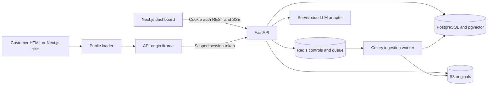

# Architecture audit

Status: PARTIALLY_IMPLEMENTED for production readiness; substantial local architecture is verified. Source inventory: `evidence/source_inventory_before.json`. Runtime versions and safe configuration flags: `evidence/environment.log`. The existing draft architecture is a target design, not proof of implemented capabilities.

## Requirements and actual stack

Read `docs/PRD.md`, `ROADMAP.md`, `ARCHITECTURE.md`, `DATABASE.md`, `API_SPEC.md`, `SECURITY.md`, `DECISIONS.md`, `DEVELOPMENT.md`, `INGESTION.md`, `CHAT_ENGINE.md`, `RAG_EVALUATION.md`, `WIDGET_DEPLOYMENT.md`, and earlier phase reports. Earlier success claims were independently checked against the current source and new executions.

- Web: Next.js 16.4.6 App Router, React 19.3.1, TypeScript 6, Tailwind 4 and reusable UI components. The dashboard talks to FastAPI; application authorization stays server-side.
- API: Python 3.13, FastAPI 0.165, Pydantic settings, SQLAlchemy 2.1.9 and Alembic 1.20.1. It is a layer-first modular monolith (`api`, `services`, `schemas`, `models`, `rag`, `integrations`, `core`, `workers`), rather than every future product domain in the draft architecture being complete.
- Data: PostgreSQL 18 with pgvector 0.8.7, tenant metadata and FORCE RLS; Redis 8.10.3 for queue/control state; Celery 5.7 API/worker/beat process types; S3-compatible storage with RustFS locally.
- Authentication: custom opaque, server-managed sessions in secure HttpOnly cookies; Argon2id password hashes and scoped one-use identity tokens. This is not an Auth.js implementation.
- Parsing: pypdf and bounded DOCX ZIP/XML parsing with defusedxml. PyMuPDF/python-docx from the planning material are not the actual extraction stack.
- Widget: vanilla TypeScript self-contained IIFE loader and iframe panel, served by the API. The planned Preact widget is not used. Built version 1.0.0 loader is 4,053 bytes gzip; version and size are in `services/api/widget_assets/v1/manifest.json`.
- AI: configurable OpenAI-compatible server-side adapter. Current execution uses `demo` generation and `hash-v1` embeddings; an implementation of the adapter is not evidence that real production models work.

Native host versions were Node 24.16.0, pnpm 11.25.0 and uv 0.10.8. Project tooling declares pnpm 11.28.12 and uv >=0.13. Recursive frontend commands were run through corepack; Python tests used the container. The older host tools are an environment discrepancy, not a demonstrated product failure.

## Implemented request/data paths

Membership/role checks establish the tenant scope; tenant-bound queries and database RLS add independent enforcement. Storage keys and document versions scope original files and chunks. Retrieval combines vectors and PostgreSQL full-text search, filtering by organization, bot and current document version. Chat assembles a bounded context, streams SSE events, saves messages and accounts for usage. Public widget capabilities expose a narrower route family than dashboard sessions.

These boundaries have runtime tests. The chat path nevertheless holds a request-scoped database session while opening another session before admission control. At default pool limits this creates AUD-01. The source selection/prompt-rendering boundary also has AUD-02: the citation source set can exceed the evidence actually rendered.

## Build and operational validation

PASS: recursive frontend lint/typecheck/test/build; backend Ruff and mypy over app/migrations; runtime Docker image build; backend migration tests; health smoke and RLS check. `evidence/health_rls.log` records the six-revision schema, service checks and no unprotected tenant tables. `baseline.xml` includes migration and database tests. Docker image build does not prove production ingress, deploy automation or recovery works.

PASS within package-advisory scope: pnpm audit and pip-audit reported no known dependency advisories. Lockfiles/builds are exercised. Container base-OS vulnerabilities, future advisories and full supply-chain assurance are NOT_TESTED. No remote CI run is claimed: `.github/workflows/ci.yml` was inspected and local equivalents executed. Final full backend Ruff lint/format checks passed (162 files formatted); mypy passed for 161 source files. The dynamically typed integration audit harness explicitly opts out of strict type checking; the small unit regressions are typed. See `evidence/audit_static.log`.

Production concerns: HTTP embedding URLs are accepted (AUD-03), uvicorn trusts forwarded addresses from every peer (AUD-04), and file parsers lack a hard per-job CPU/memory/time isolation boundary (AUD-05). Application error/logging controls have tests; prompt/document contents must remain excluded from logs. External secret management, repository history, actual bucket/IAM policy, TLS termination, backups/restore and alerting are NOT_TESTED.

## Placeholders and scope boundaries

`integrations/llm.py` demo mode is intentionally canned. It must not be represented as factual AI capability. `components/conversations/conversations-screen.tsx:61` unconditionally displays an empty inbox with disabled filters even though API messages are persisted (AUD-06). Dashboard/roadmap descriptions of future billing, channels and analytics do not establish implemented Phase 1–6 behavior. Anonymous session retention limits access/resume; physical message deletion by a retention sweep was not verified and is absent from the reviewed Phase 6 flow. Strict grounding is effectively always enforced; its configurable appearance should be reconciled with product copy.

No architectural redesign was undertaken. The immediate plan preserves the modular monolith and corrects the measured session/admission and evidence boundaries before adding scope.
