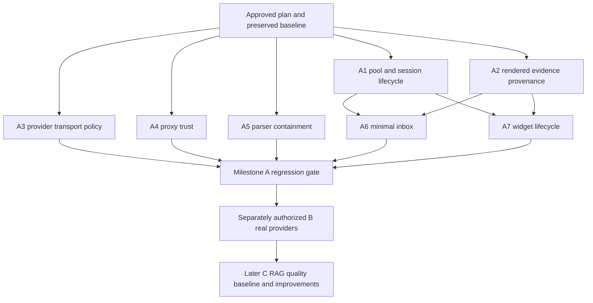

# Milestone A implementation plan — audit remediation and stabilization

Date: 22 November 2026 (Asia/Colombo). Status: **planning complete; implementation NOT_IMPLEMENTED**.

Authority: Section 10 of [MVP_IMPROVEMENT_PLAN.md](../MVP_IMPROVEMENT_PLAN.md), plus the user's instruction to produce this file and stop. This document proposes work for AUD-01 through AUD-07. It does not authorize starting that work. Begin with **AUD-01 only after a subsequent instruction** selects it. No application source, configuration, migrations, tests, generated widget assets, or original audit reports were modified during this planning pass.

## 1. Scope, method and evidence freshness

This pass read the root and API READMEs, all existing Markdown project documentation under `docs/`, the master improvement plan, and all twelve original audit reports. It inspected relevant source, schema/migrations, test fixtures, CI, Docker configuration and recorded evidence. No root/ancestor `AGENTS.md` was found. `apps/web/AGENTS.md` exists: it requires reading the installed version's Next.js guides before writing frontend code. It was read; frontend implementation has not begun. That requirement must be followed when A6 is selected.

The document set read includes `PRD.md`, `ROADMAP.md`, `ARCHITECTURE.md`, `DATABASE.md`, `API_SPEC.md`, `SECURITY.md`, `DECISIONS.md`, `DEVELOPMENT.md`, `INGESTION.md`, `CHAT_ENGINE.md`, `RAG_EVALUATION.md`, `WIDGET_DEPLOYMENT.md`, the Phase 2 security review and Phase 5/6 test reports. Draft target designs are distinguished below from shipped behavior.

**Current source check:** SHA-256 comparison of the audit's 242-file application/configuration inventory against the current repository found **zero differences**. The dedicated audit tests and actual source were additionally read, rather than inferring behavior from matching hashes. Stored JUnit, command metadata, failure logs, performance JSON, retrieval JSON/CSV, dataset/corpus and health/dependency evidence were inspected without overwriting them.

**No runtime test suite was rerun in this planning pass.** Current verification consists of source inspection, read-only artifact parsing and hash comparison. Historical runtime failures remain supported by the preserved execution evidence and unchanged implicated source. Statements such as “historical PASS” below are not fresh test results. No production database, external provider, DNS ownership record, repository history, deployment, paid service or secret store was accessed. Environment defaults in source are not a new inspection of running service configuration.

Status vocabulary: PASS, FAIL, PARTIALLY_IMPLEMENTED, BLOCKED, NOT_TESTED, NOT_IMPLEMENTED, NOT_APPLICABLE. For findings, FAIL identifies unresolved behavior; a confirmed static gap does not mean an exploit was executed. Acceptance thresholds in this plan are **proposed gates**, not measured improvements.

Only this plan is delivered now. `00_CURRENT_STATE.md`, trackers, remediation reports and evidence folders described by the master plan are future implementation deliverables; their required information for initial planning is consolidated here.

## 2. Current implementation inventory

### 2.1 Architecture and dependencies

- **Frontend:** Next.js 16.4.6 App Router, React 19.3.1, TypeScript 6.0.3, Tailwind 4.3.5, shared `@acs/ui`, Vitest 5.1.1 and Playwright 1.65.0. Confirmed in `apps/web/package.json` and root manifest. Data loading uses the project's fetch client and hooks, including `useAsyncData`; TanStack Query and a generated OpenAPI client in draft documents are not current dependencies. `apps/web/src/lib/api/types.ts:1` explicitly identifies handwritten contracts.
- **Backend:** Python 3.13, FastAPI 0.165.0, SQLAlchemy 2.1.9, Alembic 1.20.1, psycopg 3.3.9, Pydantic 2.14.4, Celery 5.7.0, Uvicorn 0.54.0 and httpx2 2.16.2; exact pins and uv lock exist. API sessions are async, ingestion sessions sync. Preserve the layer-first `api → services → models/rag/integrations/core` modular monolith.
- **Infrastructure:** Compose pins PostgreSQL 18/pgvector 0.8.7, Redis server 8.10.3, RustFS 1.0.6 and Mailpit 1.34.0. Python Redis client 8.1.0 is a separate package/version. API, worker and beat share one Python image. Current worker concurrency is two, prefetch is one, and named queues already exist. No Kubernetes, additional vector store or new service is justified by these findings.
- **Identity:** custom opaque cookie sessions, Argon2id, immediate database-backed session/membership validation, fixed owner/admin/agent/viewer RBAC, CSRF/origin controls and tenant-local GUCs. `TenantContext` is a frozen dataclass containing mutable ORM instances; this is not a deeply immutable detached authorization snapshot.
- **Data:** six migrations, `0001` through `0006`; FORCE RLS, tenant-scoped queries and composite tenant foreign keys. Actual conversation persistence is four tables: `conversations`, `messages`, `widget_sessions`, `chat_usage`. Citations and feedback are embedded in message rows. Planned `end_users`, separate `message_sources`/`message_feedback`, analytics and billing tables must not be assumed present.
- **Ingestion/RAG:** pypdf, bounded ZIP/defusedxml DOCX parsing, TXT extraction, custom HTML extraction, private S3 originals, durable jobs, retry/sweeper/outbox logic, atomic published versions, fixed `vector(1536)`, HNSW and PostgreSQL full-text/RRF retrieval. No parser process sandbox, hard parsing deadline or worker resource cap currently exists. Format/extracted-size bounds do exist and must remain.
- **AI:** configurable OpenAI-compatible server-side LLM adapter with bounded pre-output retries, cancellation, usage estimates and explicit disabled/demo modes. Hash embeddings and canned demo generation are development fixtures. The historical environment had no real provider keys; live quality remains unverified. Milestone A secures existing adapters; real model onboarding, model selection, dimension changes and reindex optimization belong to B/C.
- **Widget:** vanilla TypeScript IIFE containing host loader and API-origin iframe panel; version 1.0.0, historical/current manifest baseline 4,053 gzip bytes, enforced limit 10,240. Tokens are opaque scoped capabilities, not the JWTs described in the target architecture. Anonymous resume, exact-origin DNS proofs, public/admin separation, SSE, safe text rendering and install/live-preview UI exist. Seven-day proof renewal is manual. Retention controls access/resumption, not physical database deletion.
- **Toolchain/CI:** pnpm 11.28.12 is pinned; uv >=0.13 is required and the image pins uv 0.13.9. Historical native pnpm/uv were older; prefer the established Corepack/container recipes without automatic upgrades. `.github/workflows/ci.yml` covers lint/types/tests, migrations, RLS and builds/smoke. It does not establish a remote green run, production deployment, complete security/evaluation workflows or generated-contract drift enforcement.

No dependency upgrade is planned. Use the installed httpx2, standard-library subprocess/resource facilities and existing test frameworks first. Any additional runtime package must be separately justified, pinned and locked. The installed Uvicorn proxy middleware was inspected: it supports trusted IP/network lists, so a second client-IP parsing implementation is unnecessary.

### 2.2 Existing functionality to preserve

Historical passing evidence covers registration/login/logout, verification/reset/revocation, orgs/members/invitations/RBAC, forced RLS and IDOR rejection; chatbot CRUD/settings; upload/extraction/indexing/retry/reindex/deletion; contextual retrieval and fallback; SSE/history/feedback/usage reservations; public capability restrictions; separate-origin HTML/Next.js embeds, safe hostile text, mobile sizing, focus, resume and different-bot isolation. These are scoped tests, not a universal production assurance.

Partially implemented or absent areas: current inbox, repeated loader lifecycle, safe chat capacity, deterministic citation provenance under truncation, secure embedding transport, trusted ingress, hard parser isolation, real model/semantic quality, physical retention purge and production recovery. Future FAQ, CSV, escalation, analytics, knowledge gaps, channels and billing are outside Milestone A.

### 2.3 Documentation differences that affect implementation

1. The user's Phase 1–6 numbering differs from `ROADMAP.md` (foundations begin at P0). Use stable AUD identifiers and A1–A7 throughout.
2. `services/api/README.md` still describes reserved modules/no tables; actual models/routes supersede that foundation-era description. General architecture/API/security documents also retain future JWT/Preact, presigned upload, client generation and later schema contracts.
3. `CHAT_ENGINE.md` and `SECURITY.md` retain Phase 5 statements denying anonymous public issuance; `WIDGET_DEPLOYMENT.md`, migration `0006` and `api/widget_install.py:153` supersede them. Do not remove working anonymous issuance to match stale text.
4. `CHAT_ENGINE.md` says provider redirects are disabled. That is true for the LLM adapter, not the urllib embedding adapter. The A3 documentation update must distinguish them until fixed.
5. `INGESTION.md` mentions a `/retry` recipe in one place; the implemented route is `/reprocess` (`api/knowledge.py`). Verify current routes before writing tests/scripts.
6. `widget-preview.tsx` retains “ships in a later phase” copy for its illustrative preview; the Install tab has a real live iframe. A6/A7 should update only directly affected instructions; broad UI/copy cleanup is later work.
7. Strict grounding is currently mandatory even when the older bot flag is false. Preserve this safety policy; changing it is not part of audit remediation.

Do not rewrite these documents during planning. Update affected current-contract guidance only after the corresponding behavior is implemented and verified.

## 3. Verification of all twelve audit reports

The original files remain immutable historical records. Differences and limitations are recorded here, not patched into them.

| Audit report | Verification against current source and preserved evidence | Planning consequence |
|---|---|---|
| [01 Executive summary](../audit/01_EXECUTIVE_SUMMARY.md) | Score 80.5, phase totals and stated test accounting agree with stored matrix/results. The seven implicated source paths remain unresolved. No new release assessment or runtime run was performed. | Retain NOT READY as the last readiness decision; A completion alone cannot approve release. |
| [02 Implementation matrix](../audit/02_PHASE_IMPLEMENTATION_MATRIX.md) | JSON has 60 rows: 45 PASS, eight PARTIALLY_IMPLEMENTED, three FAIL, three BLOCKED, one NOT_TESTED; weighted scores sum to 80.5. Referenced source paths exist. 51 runtime-exercised rows include failures, and some PASS rows are static or component-level evidence. | Preserve row scopes and rubric; do not reinterpret 80.5 as percent complete or 51/60 as a pass rate. |
| [03 Architecture](../audit/03_ARCHITECTURE_AUDIT.md) | Manifests, six migrations, actual layer layout, opaque auth/capabilities and vanilla widget support the detected stack. Production operations and remote CI remain unverified. | Preserve architecture; avoid implementing draft future modules while fixing A. |
| [04 Functional results](../audit/04_FUNCTIONAL_TEST_RESULTS.md) | `baseline.xml` has 582 tests/no failures; frontend logs report 213+7 and browser log five expected/no unexpected. Named API workflow asserts vectors, isolation and deletion. Browser accounts are separate from the named disposable fixture. | Historical 807 passing tests are a preservation baseline, not one fully verified real-AI journey. |
| [05 Security](../audit/05_SECURITY_AUDIT.md) | Source and two failed unit regressions support AUD-02/03; QueuePool trace supports AUD-01. AUD-04/05/06/07 remain source-confirmed gaps with limited historical runtime evidence. | Keep severities and distinguish confirmed defects from conditional exploitation. Expand verification as specified below. |
| [06 RAG evaluation](../audit/06_RAG_EVALUATION_REPORT.md) | Dataset/results/CSV each have 100 cases; corpus has 20 documents. Stored flags yield 68 hits/80 answerable =85%; every live answer is null/BLOCKED. Harness uses expected filename plus all phrases in one top-five chunk. Follow-ups explicitly prepend prior question. | No fresh quality result; freeze original labels/corpus. No semantic-quality remediation claim in A. |
| [07 Performance](../audit/07_PERFORMANCE_REPORT.md) | Original stages: 1→10 HTTP 200; 10→10 HTTP 500; 50→50 HTTP 500; 100→100 HTTP 500. Fresh historical confirmation: 1 HTTP 200/9 HTTP 500. Trace names `find_conversation` and 30-second QueuePool wait. | A1 must remove nested checkout and assert completed streams/fairness, not only count HTTP codes. |
| [08 Widget validation](../audit/08_WIDGET_VALIDATION_REPORT.md) | Browser source tests different bot keys, HTML/Next.js, resume, hostile text, focus, sizing and preview. Loader lacks same-key dedup/cleanup; these were not browser-proven in the audit. | A7 adds same-key lifecycle and error-path tests without discarding passing isolation tests. |
| [09 Missing features](../audit/09_MISSING_FEATURES_AND_BUGS.md) | Listed defects/placeholders remain in source. No new app changes were found within the original inventory. | Minimal inbox is explicitly brought into A6 by the improvement plan; advanced management remains later. |
| [10 Fix plan](../audit/10_PRIORITIZED_FIX_PLAN.md) | Priorities agree with HIGH availability and provenance/transport risks. Its real-provider release gate spans work beyond A. | Use A1 first, then focused A2–A7 tasks; defer live model work to separately selected B. |
| [11 Readiness](../audit/11_MVP_READINESS_REPORT.md) | Last decision NOT READY is consistent with open HIGH and blocked live AI. No finding is resolved by this plan. | Do not issue a new score/release approval from read-only analysis. |
| [12 Execution log](../audit/12_TEST_EXECUTION_LOG.md) | Commands/test selectors exist. JUnit shows 582 baseline +3 initial added +1 workflow +1 pool +2 security invocations. Added audit tests were later formatted, so historical traceback line numbers differ from current lines. Logs remain authoritative for those runs. | Use new improvement output paths; preserve original logs. Native Windows cannot directly collect the performance helper's `resource` import; use Linux container. |

Additional test-evidence limitations found during this pass:

- `tests/integration/api/audit/test_implementation_audit.py:415` applies its no-500 assertion **only if `AUDIT_CONFIRM_POOL` is set**. The full 1/10/50/100 invocation is currently a measurement collector. A1 must add an always-enforced full-workload acceptance test; a green collector is insufficient.
- That helper counts HTTP 200 as success without validating a terminal SSE `done` status/content. A stream that emits an error could be miscounted. Parse terminal events in the new capacity tests.
- Its leakage counter at lines 188–193 exempts `audit.pdf`/`audit.docx` by title. Although these are controlled fixtures, a stronger new isolation assertion must whitelist actual tenant-owned document IDs, not titles. Do not claim the existing counter proves all possible leakage absence.
- The fixture adjusts request/usage limits and uses a 10 ms provider. Keep that controlled infrastructure comparison, plus a separate test with real default quotas/limits. It does not establish provider latency or production capacity.
- The four final distinct audit functions account for one pass/three failures, giving historical 808/811; repeated invocations give 809 passes/five failures out of 814. One initial failure was an audit DOCX-construction error. Neither the 100 evaluation rows nor build/static commands are additional pytest passes.
- Historical package scanners found no known advisories in their scope. No fresh vulnerability-database lookup was performed here; no present-day zero-vulnerability guarantee is made.

## 4. Findings confirmed in current source

| Finding | Current disposition | Primary current source | Evidence boundary |
|---|---|---|---|
| AUD-01 HIGH | **FAIL — unresolved** | `api/deps.py:62,93,122`; `api/conversations.py:118`; `services/conversations.py:38,188,192`; `core/db.py:15` | Historical reproducible pool failure plus unchanged source. Adjacent nested-session paths identified below are static observations, not new load measurements. |
| AUD-02 MEDIUM | **FAIL — unresolved** | `rag/retrieval.py:182,187`; `services/chat_prompt.py:25,41,51`; `services/conversations.py:412,452` | Original ampersand regression remains present; historical failure log. |
| AUD-03 MEDIUM | **FAIL — unresolved** | `core/config.py:224,247`; `rag/embeddings.py:108,129`; `integrations/llm.py:46` | Production HTTP embedding acceptance supported by existing failed regression; no actual key disclosure was attempted. |
| AUD-04 MEDIUM | **PARTIALLY_IMPLEMENTED — trust gap confirmed** | `services/api/Dockerfile:45`; `core/request_meta.py:33`; Compose `api` service | Wildcard runtime trust exists. Direct public ingress exploitation/topology **NOT_TESTED/BLOCKED**. |
| AUD-05 MEDIUM | **PARTIALLY_IMPLEMENTED — isolation absent** | `rag/extract.py:90,171`; `rag/pipeline.py:179,371`; `rag/crawler.py:177`; `workers/celery_app.py:27`; `workers/tasks/ingest.py:31,40` | Existing validation is real; hard process deadlines/resources are absent. No hostile resource-exhaustion exploit was run. |
| AUD-06 LOW | **PARTIALLY_IMPLEMENTED — inbox absent** | `conversations-screen.tsx:17,44,59`; `api/conversations.py:84,103`; `models/conversations.py:19` | UI never requests conversations; existing per-bot list/transcript are real but capped and unpaginated. |
| AUD-07 LOW | **PARTIALLY_IMPLEMENTED — lifecycle absent** | `apps/widget/src/loader.ts:11,27,41`; `panel.ts` mount/load/submit/pagehide paths | Unconditional frame/listener per evaluation; no registry or teardown. Different-bot isolation does not cover duplicate same-key execution. |

Source paths in the table are relative to `services/api/app/` unless a longer path or frontend filename is given. Detailed file sets below remove ambiguity.

## 5. Implementation order and dependency map

Deliver seven separately reviewable tasks, ordered **A1 → A2 → A3 → A4 → A5 → A6 → A7** as a conservative single-workstream sequence. A2/A3/A4/A5 do not technically require each other's code, but all touch shared configuration/validation and need coordinated reviews. There is no authorization to start parallel implementation or later milestones in this planning request.



A4 is required before trusting IP-based deployment/load conclusions. A5 must pass real worker isolation checks before claiming ingestion fairness. A6 needs A1's safe read/session pattern and A2's reliable source display. A7 can be designed independently but its integrated load/cancellation gate needs A1 and source display needs A2.

Later dependency context only: D extends stabilized ingestion; E extends A6; F consumes real persisted usage/conversations; G needs approved knowledge, conversation and event flows; H improves established flows; I validates the actual deployment/operations; J independently evaluates the resulting system. These later milestones are neither implemented nor detailed as work items here. Milestone A closure does not eliminate B–J release gates.

## 6. A1 / AUD-01 — database connection pool starvation

### Root cause and affected paths

`get_db` yields a session through request completion. Session/user/membership queries begin a transaction and retain its checked-out connection. `send_message` opens another session through `find_conversation`; `_prepare` repeats that lookup before org limiting/acquisition. With pool_size=5 and max_overflow=5, ten outer transactions can occupy all ten connections while waiting for second checkouts. `prepare`'s timeout does not cover the route's initial lookup. SQLAlchemy pool wait is implicitly 30 seconds; `connect_timeout=5` only bounds establishing a driver connection, not waiting for a pool slot.

Additional source-confirmed contributors to address within this lifecycle repair:

- `api/deps.py:103` calls `identity/sessions.py:66`'s separate `touch_session` transaction while the auth lookup session is still held; stale idle-touch requests need a regression too.
- `_prepare` holds its DB session across `asyncio.to_thread(embed_query)` and external embedding latency. Cancellation of the await does not itself stop a synchronous thread. Bound provider work, release DB resources before it, and revalidate on return.
- `widget_chat.authenticate:76` awaits `widget_domains.resolve:59`, opening another session while capability lookup holds one. `bootstrap:102,120` opens a conversation-creation session inside an outer session. Public read/bootstrap paths therefore require the same review even though the historical saturation test exercised dashboard send.
- Transcript/create/feedback/member-issued widget routes open service sessions while generic auth dependencies hold their session. Do not repair only one call site and leave the shared scarcity cycle.

### Proposed solution

1. Introduce a **short-lived chat authorization dependency**, returning a frozen scalar access context (validated user/session/membership/role/org identifiers and permitted action; public capability context additionally binds bot/conversation). Do not pass attached ORM objects or log bearer/cookie values. Reuse existing validation/policy functions; avoid a second, weaker authorization system. Existing CRUD transaction dependencies need not be globally rewritten, but their idle-touch nested checkout must be removed safely.
2. Perform identity/membership/verification/org checks and any idle timestamp update in one short, explicit auth unit of work; close it before a handler opens a service transaction. Re-establish user/org GUCs in every new transaction. Do not add blanket commits to `get_db`, globally clear tenant GUCs, accept organization claims from headers, or commit another handler's pending writes.
3. Apply cheap existing public-IP controls first; only use **authenticated server-derived org IDs** for tenant rate/concurrency admission. Acquire the existing Redis org/conversation lease before expensive preparation. Deduplicate conversation lookup and channel checks within one scoped preparation read. Do not reveal a foreign resource through a different error body or use an unvalidated ID as authorization.
4. Split preparation into bounded DB reads → closed-session embedding work → tenant-scoped retrieval/reservation/persistence transactions. Revalidate dashboard session/membership/permission and bot/org/capability state at the post-network boundary before provider dispatch/reservation commit. Active streams may complete under the documented admitted-request policy; every next request must see revocation, expiry, role changes and key/domain removal. Test changes between the initial lookup and preparation, not just sequential requests.
5. Rework public resolver/bootstrap operations to use sequential short transactions or an explicit caller-owned session helper; never check out a second connection while retaining the first. Preserve atomic token rotation, resume locking and lifetime message counters; avoid creating orphan conversations on failed issuance.
6. Add bounded **per-process chat setup** admission owned by `AppServices`, leaving at least two of the default ten pool connections available for other work. Proposed setup capacity <=8 with the existing org cap=3; streams release setup permits before provider generation. Keep Redis org/conversation caps across API processes. Use fail-fast/bounded acquisition, not an unbounded in-memory queue. Short auth/lookups remain bounded too. This is a candidate capacity policy to validate, not a reason to increase the pool.
7. Add `DB_POOL_TIMEOUT_SECONDS` (proposed default 2 s) and bounded preparation/lock waits. Map actual pool-admission exhaustion to sanitized `503 chat_unavailable` with Retry-After; org/conversation saturation remains `429 chat_busy`. Only catch recognized capacity exceptions; genuine defects must remain visible. After SSE headers, retain the existing `error`/`done` failure protocol.
8. Ensure every acquired setup permit/Redis lease is released on success, exception, pre-stream disconnect, cancellation and failed persistence. Preserve conservative uncertain-usage charging; do not refund a possibly billed attempt. No reservation/message rows for an admission rejection; a committed generation attempt must remain auditable if finalization fails.

### Proposed file set and dependencies

Existing: `services/api/app/api/deps.py`, `api/conversations.py`, `api/widget_chat.py`, `services/conversations.py`, `services/identity/sessions.py`, `services/tenancy/context.py` (only if a shared snapshot type belongs there), `services/chat_controls.py`, `services/widget_chat.py`, `services/widget_domains.py`, `services/container.py`, `core/config.py`, `core/db.py`, and recognized-capacity mapping in `core/errors.py` as needed. Add a focused `services/chat_access.py` if it keeps policy reuse/lifetimes clear. Update `.env.example`, Compose environment wiring and `docs/CHAT_ENGINE.md` after verification. No schema migration is expected.

Dependencies: existing Redis Lua leases, session validation, transaction-local RLS, quota advisory locking and disconnect finalization. No real AI provider is needed. Cross-cutting auth changes require all identity/tenancy/permission tests, not only chat tests.

### Regression tests and measurable acceptance

- Keep the existing failing short pool regression unchanged and make it pass. Add strict typed tests under `tests/integration/api/mvp_improvement/test_chat_capacity.py` and lifecycle/auth cases in the existing conversation/auth suites. Preserve the old collector and add a stronger **unconditional** full-stage gate rather than skipping it.
- Repeat original fixture stages 1/10/50/100, preserving request counts, default pool 5+5 and org cap=3. Require **zero HTTP 500s, zero harness timeouts/unhandled exceptions**, at least one completed answer at each stage, and only documented pre-stream 429/503 for excess valid traffic. HTTP 200 counts as success only with terminal `done`, expected nonempty fixture content, successful status and persisted message/usage. Unexpected SSE errors fail the admitted-success check.
- Separate successful, admitted-failed and rejected latency distributions. Proposed local fixture gates: successful P95 <=2 s; controlled rejection P95 <=3 s. They are infrastructure gates on this small fixture, not production SLAs or real-model TTFT claims.
- During tenant A saturation, tenant B makes at least 20 authorized lightweight reads and five sequential fixture chats: zero errors, all five chats complete, read P95 <=1 s and <=2x its separately measured idle P95 +100 ms. Record actual outcomes; if host variance prevents a defensible timing result, mark timing NOT_TESTED/BLOCKED rather than relaxing the correctness/fairness requirement silently.
- Instrument checkout/checkin counts and outstanding sessions without logging SQL parameters. After each stage/cancellation, outstanding checkouts and setup permits return to the pre-stage baseline within 2 s; no connection is held by a provider-only paused stream. Redis active/conversation leases are empty after graceful cleanup. Check actual database message/reservation states and cumulative limits, not only mocked release calls.
- Cover stale idle-touch bursts, public bootstrap/auth/history, same-conversation races, Redis outage, forced pool acquisition failure, provider failure, embedding failure/timeout and ASGI 2.3/2.4 disconnect/send errors. Pool-size-one tests must establish no nested checkout, with concurrency/admission settings scaled appropriately.
- Repeat role removal/session revocation/org restriction, foreign IDs, guessed public capabilities, pooled GUC reset and RLS tests. Zero unauthorized reads/writes. No permission caching or quota relaxation in application defaults.

Security risk: detached authorization can become stale; splitting transactions can lose GUCs or token atomicity; early failure can leak leases or change usage. These are release-blocking regressions. Rollback: revert the focused code/config change in a local/staging image, keep records and conservative usage; no destructive database downgrade. Do not revert to a vulnerable production path as a normal rollout strategy.

## 7. A2 / AUD-02 — exact rendered citation provenance

### Root cause and proposal

`assemble` limits raw source characters, while `render_context` slices before HTML escaping and counts the expanded result. A 2,500-ampersand body becomes 12,500 characters, crosses the 12,000 renderer ceiling, and prevents source 2 rendering. `assemble:41` nevertheless returns both selected chunks. Streaming stripping and final `citations_for` use that larger list, so `[2]` receives metadata for unseen evidence. Whole-prompt byte budgeting does not repair that mismatch.

Create a single deterministic evidence-rendering result: prompt text plus an immutable map/list of the **exact included source IDs, authorized chunk metadata and rendered excerpts**. Assign stable, deterministic numeric IDs after fitting the final source set; preserve their identity throughout the one generation. Budget escaped UTF-8 bytes, metadata, delimiters, guard/preferences, question and history/framing consistently. Drop old complete history pairs first, then trim/omit lower-priority evidence according to one documented policy. Never split Unicode or an escaped entity/tag. A source with no actual body must not remain citable.

Use that exact set in `Turn`, streamed marker filtering, final citation snapshots and saved messages. Validate unknown/zero/overlong/malformed/omitted markers safely across provider delta boundaries. Preserve existing `meta/delta/error/done` event names and citation fields. A numeric marker is not permission to re-fetch an arbitrary document; citations must originate only from the authorized retrieval result. Consider an internal org/bot ownership invariant at evidence construction; `RetrievedChunk` currently does not carry org_id, so do not claim that `citations_for` alone can enforce tenant ownership.

### Proposed files, dependencies and tests

Existing: `services/api/app/rag/retrieval.py`, `services/chat_prompt.py`, `services/conversations.py`; existing tests `tests/unit/test_chat_provider.py`, `tests/unit/rag/test_prompt_safety.py`, `tests/integration/api/test_conversations.py`. Add focused typed renderer/citation tests in `tests/unit/mvp_improvement/test_rendered_evidence.py`. Preserve `tests/unit/audit/test_prompt_evidence.py:26`. No schema migration or new dependency expected; JSON citation snapshots already exist. A1's lifecycle refactor must carry the new evidence result without duplicating rendering.

Acceptance:

- Original ampersand regression passes; **zero markers resolve to a source absent from the final model input** in all deterministic fixtures.
- Cover escaped `&<>"'`, large title/URI metadata, multilingual UTF-8, exact budget boundaries, truncated/omitted context, long history, empty evidence and multiple valid/repeated citations. The final input obeys the byte-bound allowance; instructions/question remain intact or receive the existing pre-stream context-limit error.
- Split `[2]` and invalid markers across provider events; stripped content and final persisted `done` agree. Empty evidence yields the configured fallback, no provider call and zero citations.
- Foreign/deleted/superseded source IDs never enter the rendered set; manipulated document IDs/markers cannot obtain another tenant's metadata. Identical same-tenant/different-bot texts stay bot-scoped.
- Existing valid citations, stored historical snapshots, source links and widget/playground source display remain compatible. No private full prompt/debug output is added to browser responses or logs.

Risk: renumbering after streaming begins or separately re-rendering can corrupt references. Construct once before dispatch. Rollback: code-only revert for controlled environments; retain existing historical citation snapshots. Semantic support of a citation is **BLOCKED until real-model evaluation** in separately selected B/J; deterministic A2 success cannot meet the 95% semantic target by itself.

## 8. A3 / AUD-03 — provider transport security

### Root cause and proposal

`Settings._chat_guards:230` already requires an HTTPS LLM URL/key and rejects username/query/fragment; demo is forbidden in production. Embedding settings lack equivalent URL validation. `OpenAICompatibleEmbedder:108` accepts either HTTP/HTTPS by prefix, and `urllib.request.urlopen:129` uses default redirect behavior and environment proxy discovery. The audited HTTP risk is conditional on operator configuration; there is no observed real secret leak. The current LLM adapter already has `follow_redirects=False`, `trust_env=False` and default certificate verification; preserve those controls.

Use one shared, startup-enforced provider URL policy for configured LLM/embedding adapters. Require HTTPS for production **and staging**. Validate a real hostname, valid port, supported scheme, and reject userinfo (including password-only/encoded forms), query, fragment, whitespace/control characters, backslashes and ambiguous authority forms. Permit a base API path. Error messages identify field/policy without echoing a credential-bearing URL or key; settings-validation logging must not expose invalid raw inputs.

Retain strict HTTPS by default in local/test. If needed, add an explicit `ALLOW_INSECURE_LOCAL_PROVIDERS=false` opt-in restricted to `APP_ENV=local|test` and literal loopback/localhost endpoints. Any container-local hostname exception must be an explicit operator allowlist, never a tenant-controlled URL or broad private-network exception. Production/staging reject the opt-in. Document this addition as a deliberate expansion of the current LLM local policy, not an existing capability.

Prefer moving embedding HTTP transport to the already installed **sync httpx2 client**, with redirects disabled, environment proxies disabled unless a deliberate trusted configuration is later approved, TLS verification enabled and bounded connect/read/overall work. Preserve the Embedder protocol, batching/dimensions/ordering and permanent/transient error taxonomy. No SDK/provider duplication, live model onboarding or embedding-space migration is part of A3. TLS verification must not become an operator `verify=False` shortcut. Reject every 3xx rather than following same-host exceptions unless a concrete compatibility requirement is reviewed.

### Files, tests and acceptance

Existing: `core/config.py`, `rag/embeddings.py`, `integrations/llm.py` (only shared validation/consistency if required), `.env.example`, Compose environment wiring, `docs/CHAT_ENGINE.md`, `docs/INGESTION.md`, `docs/DEVELOPMENT.md`. Optional new pure `core/provider_urls.py`. Update existing embedding transport fixtures to the actual secured transport while preserving behavioral assertions; keep the audit HTTPS regression unchanged. Add `tests/unit/mvp_improvement/test_provider_transport.py` plus a disposable local TLS transport test. No package upgrade or migration expected.

- Existing production HTTP embedding regression passes. Production/staging HTTP endpoints, credentials, malformed authority and unsafe URL components fail startup; valid HTTPS base paths pass. Local HTTP works only under the explicit bounded opt-in policy.
- Test 301/302/303/307/308, including cross-host and HTTPS→HTTP redirects. The destination receives **zero requests/credentials/body**; failures are sanitized. An in-memory mocked response verifies redirect policy; it does not prove TLS verification.
- Use a real local TLS fixture with a synthetic test CA/certificate: trusted chain succeeds; untrusted issuer, expired certificate and wrong hostname fail. Keys/documents are fictional. No production trust store or system certificate setting is changed. Test cert material is test-only and no runtime credential.
- Provider proxy environment variables cannot silently redirect sensitive traffic; no insecure verification flag is introduced. Check error logs with marker secrets and document strings: **zero matches**.
- Existing embedding ordering/batching/shape/model consistency, retry classification and LLM streaming/cancellation/pre-output-retry tests remain green. Never retry a partially emitted answer.

Dependencies: startup validation must apply in API and workers; split database lifetime from network work in A1. Risk: stricter URLs/redirect rejection may break intentionally local endpoints. Document migration/configuration steps using placeholders; no silent downgrade. Rollback: restore compatible code/config only in local testing; do not weaken production HTTPS to regain connectivity. Real remote-provider availability remains outside A3 validation.

## 9. A4 / AUD-04 — trusted proxy configuration

### Root cause and proposal

Production Docker CMD unconditionally passes `--forwarded-allow-ips "*"`. Uvicorn then accepts peer-supplied forwarding metadata; `RequestMeta` correctly uses `request.client`, but that value is already rewritten. A directly reachable API can therefore permit spoofed IP attribution/limits. Org/capability/email limits are independent and must remain. Local Compose uses the development image/CMD, so testing only that stack does not prove the runtime image is fixed.

Remove the hardcoded wildcard. Use Uvicorn's existing `FORWARDED_ALLOW_IPS` configuration as the single authority with **no trusted proxies by default**; ensure the runtime default is explicitly empty rather than unintentionally inheriting Uvicorn's loopback trust. Add startup validation of configured literal IPs/CIDRs (IPv4/IPv6); reject `*`, /0 equivalents and malformed/ambiguous entries in deployed environments. Pass the same value through the launcher/environment without shell interpolation mistakes; exec-form CMD does not expand `$VAR`. Do not parse `X-Forwarded-For` again inside `RequestMeta`.

Document a deployment contract: ingress must come only from approved proxy addresses; proxy removes/replaces client-supplied forwarding headers and supplies the real peer chain; API direct access is denied by network policy; DB/Redis remain private. Broad private CIDRs containing untrusted workloads are not a safe convenience default. Validate actual topology separately before claiming production protection.

Files: `services/api/Dockerfile`, `core/config.py` and (only if needed) a small explicit runtime launcher, `.env.example`, Compose environment wiring, `docs/DEVELOPMENT.md`, `docs/WIDGET_DEPLOYMENT.md`, `docs/PHASE2_SECURITY_REVIEW.md` through an additive current-status note after verification. Do not edit original `docs/audit/` reports. `core/request_meta.py` should continue to consume the resolved ASGI peer, with no duplicated header trust logic. No migration/dependency change expected.

Tests: new `tests/unit/mvp_improvement/test_proxy_trust.py` exercising installed Uvicorn middleware, plus a disposable runtime-image HTTP integration test. Cover untrusted peers with forged XFF/proto, trusted IPv4/IPv6 peers, multi-hop and duplicate headers, malformed/empty chains and untrusted prefixes. Validate the image entrypoint, not just a standalone helper.

Acceptance: untrusted direct callers cannot choose the IP/scheme seen by application limiters; forged header variations exhaust the same IP bucket. Approved proxy chains resolve to the intended first untrusted client under documented topology. No implicit wildcard/broad trust exists; invalid deployed settings fail startup. Existing rate/CSRF/cookie/capability tests pass. Actual direct-ingress denial and proxy sanitation remain **BLOCKED** until an authorized deployment exists; retain that distinction in the A4 closure report. Rollback must never restore wildcard production trust; use direct-peer identity or a verified explicit allowlist.

## 10. A5 / AUD-05 — parser resource isolation and worker recovery

### Root cause and proposal

PDF/DOCX parse CPU/memory consumption can occur before or between existing page/text/ZIP bounds. `extract_stored` and crawler HTML extraction run in the worker process. Celery tasks specify retries/acks but no execution deadlines; Compose supplies no worker memory/CPU constraints. Late acks/prefetch and a stuck-job sweeper support recovery, but cannot stop a currently pathological parser. One two-slot worker is shared across queues; fairness is not guaranteed merely by naming queues.

1. Add a parent-supervised **fresh parser subprocess** for PDF/DOCX/TXT and HTML extraction, including both stored-HTML reprocessing and `crawler.py:177` so that live crawl cannot bypass the boundary. Keep vetted network fetching and embedding in the existing parent orchestration. Reuse pure parsing functions behind a narrow runner interface; do not instantiate Runtime/DB/storage/provider clients in the parser child.
2. Pass bounded data/limits/format through a private temporary file or framed pipe; return a bounded validated JSON representation of blocks/title/pages. Never unpickle parser output, run shell commands, interpolate filenames into executable commands or log stderr/document contents. Whitelist child environment; exclude DB, S3, email and provider secrets. Close inherited descriptors; spawn/exec rather than inheriting initialized DB/Redis clients through a worker fork. A subprocess boundary alone is resource containment, not a complete exploit/network sandbox; document remaining OS/egress restrictions.
3. Proposed Linux defaults for evaluation: parser wall deadline 60 s, CPU budget 30 s, address-space limit 512 MiB, bounded descriptors, input <=current upload/fetch cap and result envelope <=32 MiB. Validate overhead/compatibility against existing supported documents before freezing limits; do not silently increase budgets to pass a malicious fixture. Enforce limits in the child before parsing; parent terminates then kills/reaps the process group within 2 s of deadline. Bound IPC reads and error output, too.
4. Add task-specific Celery soft/hard limits (initial proposal document soft=120 s/hard=180 s). Crawl gets a separately bounded budget derived from configured page/fetch/delay bounds, capped by an explicit operator maximum; a valid 200-page crawl cannot be accidentally assigned a 180-second document budget. Parser deadlines remain per page. Add worker container memory/CPU/PID limits sized for two slots plus parent overhead (initial proposal 2 GiB, two CPUs, 128 PIDs); verify enforcement rather than assuming every Compose engine honors them.
5. Map deterministic parser timeout/resource exhaustion to safe permanent codes (`parse_timeout`, `parse_resource_limit`) with manual retry available. Distinguish transient worker loss/storage/provider failures with existing bounded retry/backoff. On soft failure, close child/temporary files and transition job/document safely. On hard kill, the parent cannot rely on `finally`: prevent orphan children, reconcile via the existing sweeper and ensure the last published version remains available.
6. Add per-org ingestion admission before claiming expensive work, with bounded rescheduling rather than a worker slot sleeping for a permit. For the two-slot fixture, propose max one active heavy task per tenant so tenant B retains a slot; keep task/database state authoritative. A heartbeat alone is not a fencing token: ensure attempt-aware conditional publish/fail transitions prevent a stale/killed attempt from overwriting a newer claim. Existing attempt number may suffice if all transitions are guarded; add a migration only if a durable owner/generation token is required.
7. Ensure deletion/cancellation during parse cannot republish deleted content. The runner must be cancellable by the orchestrator, children must be reaped, and temporary paths removed on every normal/error path. For worker death, use OS/process supervision plus a bounded orphan-temp sweep; never recursively delete a caller-supplied path.

Linux Docker is the proposed supported production isolation environment. Windows desktop users can run it through Docker Desktop. Native Windows `--pool=solo` does not establish POSIX signal/RLIMIT enforcement; provide explicit local-only limitations or a tested Windows Job Object equivalent. Do not report hard CPU/memory isolation PASS on a platform where it is unavailable. Production startup must fail closed if required containment cannot be established. No Kubernetes or new parsing service is needed.

### Proposed file set and verification

Existing: `rag/extract.py`, `rag/html_extract.py`, `rag/pipeline.py`, `rag/crawler.py`, `rag/crawl_job.py`, `rag/maintenance.py`, `rag/runtime.py`, `rag/errors.py`, `workers/celery_app.py`, `workers/tasks/ingest.py`, `core/config.py`, `docker-compose.yml`, `.env.example`; `services/api/Dockerfile` only if runner packaging/OS policy needs it. Proposed new `rag/parser_runner.py` and `rag/parser_process.py`. Optional next Alembic revision/model changes only if durable fencing cannot use existing `attempt`; preserve all tenant/RLS constraints. After validation update `docs/INGESTION.md`/development guidance.

Extend `tests/unit/rag/test_extract.py`, `test_html_and_crawler.py`, `tests/unit/test_celery.py`, `tests/integration/api/test_knowledge_jobs.py`, existing deletion/reindex/live-ingestion tests. Add `tests/unit/mvp_improvement/test_parser_runner.py` and Linux worker integration tests with bounded slow/CPU/allocation fixtures. Do not use actual decompression bombs or uncontrolled OOM payloads; child limits must contain the tiny fixtures and total test time must be bounded.

Acceptance:

- PDF/DOCX/TXT/HTML supported fixtures still index with correct page/heading metadata and 1536-d vectors; original malformed/size/SSRF/version tests pass.
- A test wall budget of 0.5 s terminates a bounded 5-second slow parser by <=2.5 s total after spawn readiness. CPU/memory fixtures hit their configured child caps, the worker parent survives, no secret/content appears in logs, no child/temp artifact survives beyond the 2-second cleanup grace. Record child PIDs, exit reasons and effective limits, not private payloads.
- Timed-out documents have an explicit safe failed state and no partial new vectors; a failed reindex retains the previous published version. Transient worker loss retries no more than `max_attempts`; after that it fails visibly. Deleted sources remain absent.
- Kill/restart only an **isolated test worker**, not the developer's shared worker. Assert recovery within one configured stuck threshold plus one sweep interval plus 5 s; use shorter isolated test settings for a bounded test. Old attempts cannot publish/fail a newer attempt, and duplicate delivery cannot duplicate chunks.
- With two isolated worker slots, tenant A's bounded slow job does not consume both; tenant B's one normal document starts within 2 s and reaches ready within 5 s in the controlled hash fixture. Record queue/execution times separately. CPU/memory containment, public-network sandboxing and production operational fairness are distinct claims.

Risk: platform-specific limits, spawn/import overhead, large IPC results, worker hard-kill orphans and stale-attempt races. Dependency: A1/A3 configuration conventions and existing durable job/version lifecycle. Rollback preserves published chunks and job history; stop admitting problematic work rather than silently disabling the production containment boundary.

## 11. A6 / AUD-06 — minimal persisted conversation inbox

### Root cause and bounded solution

The component fetches chatbot options only; filters are disabled and “No conversations yet” is unconditional. API already has a per-bot latest-50 list and a latest-200 transcript, but no org-wide paginated inbox. `Conversation` has created_at/channel, not the target schema's title/status/last_message_at. `Message` has created_at/citations/feedback. Do not build the UI against nonexistent target tables or count fields.

Add a minimal organization-scoped listing, optional chatbot filter, creation/last-message timestamps, selected transcript, actual message states/source snapshots and pagination. Use `conversation:read` for all reads (including viewers); public tokens never authorize these routes. Preserve “widget conversations may only be advanced by their own capability” in send logic. Exclude advanced search, resolution/escalation, exports, analytics, clustering and moderation.

Proposed additive contract:

- `GET /api/v1/orgs/{org}/conversations?chatbot_id=<uuid>&limit=25&cursor=<opaque>` returns `data`, `next_cursor`, `has_more`. Items contain id, chatbot_id/name, channel, created_at and nullable last_message_at derived from persisted messages. Sort **newest conversations** by `(created_at DESC, id DESC)`; do not label that as latest activity. Derive last-message timestamps only for the bounded page in a bounded SQL query, avoiding per-row queries or full-tenant transcript loading.
- `GET /api/v1/orgs/{org}/conversations/{id}/messages?limit=50&cursor=<opaque>` pages older transcript history with safe timestamps/citation snapshots/status/feedback. Preserve the existing GET transcript and per-bot latest-50 response defaults for the playground. New cursor responses make truncation explicit; conversations with >200 messages remain reviewable.
- Strictly validate cursor encoding/size/timestamp/UUID/sort direction and bind it to org/filter scope. Malformed or mismatched cursors return documented `400 invalid_cursor`. Follow the current opaque-cursor convention; cursors are pagination hints, never authorization. The draft signed-cursor target is not claimed achieved by an unsigned implementation. Every page reapplies membership/RLS/org/bot filters even if the cursor is crafted.

Use existing UI components, loading/error/empty states and request client. Reset selection/pages immediately on org/filter change; ignore/abort stale responses and **clear previously loaded content**, not only ignore new stale results. `useAsyncData` ignores late writes but currently retains its prior `data` across dependency changes, so use a scope-keyed inbox state/component or a narrowly justified hook extension with regression tests. Read the installed Next.js guides before implementation per `apps/web/AGENTS.md`; no new design system or query library is required.

### Files, tests and acceptance

Existing: `services/api/app/api/conversations.py`, `services/conversations.py`, `schemas/conversations.py`; `apps/web/src/components/conversations/conversations-screen.tsx`, `apps/web/src/lib/api/index.ts`, `apps/web/src/lib/chat.ts`, appropriate existing types/client and shared state helpers. Proposed transcript/list components/tests can stay under the conversations directory. Add one next Alembic revision for justified org-created-id and org-bot-created-id cursor indexes; the existing messages `(org_id,conversation_id,created_at,id)` index can support transcript pagination. Do not add target-design analytics/status tables. If A5 needs a migration first, select the next free revision in one linear chain rather than assuming both can use 0007.

Add `tests/integration/api/mvp_improvement/test_conversation_inbox.py`, React component tests and `apps/web/e2e/conversations.spec.ts`. Preserve existing playground chat and widget E2E tests.

- A persisted widget and playground conversation appears after refresh with actual bot/channel/timestamps. Chatbot filter shows only that bot; true empty data, loading, retryable error, 401/403 and inaccessible 404 are distinguishable. No hardcoded rows/counters remain in the inbox.
- Seed at least 75 conversations and a transcript of 250 messages: every expected record is reachable exactly once across stable pages, with deterministic tie-breaking. Test identical timestamps, invalid/cross-org/filter cursors and refresh while new rows are inserted; document snapshot semantics rather than promising a fixed snapshot across live writes.
- Two tenants, every role and public capabilities: zero foreign metadata/transcripts; viewers read but cannot mutate; missing/changed membership is enforced on each page. Source snapshots survive source deletion without becoming a private-file download.
- Delayed responses from tenant A never render in tenant B's selected scope. Test org switch, filter switch, logout/unmount, error retry and transcript selection races. Content/links render safely; no prompt/debug fields or new secret-bearing diagnostics are returned.
- Capture SQL/query timing on a disposable 10,000-conversation fixture: proposed local list P95 <=300 ms (20 warmed reads), bounded page size <=100, no N+1 transcript queries and usable index plan. Document hardware and separate this fixture target from production capacity.
- Keyboard-operable filters/list/transcript, focus and mobile 390px layout; no page-wide horizontal overflow. Full WCAG certification remains later verification.

Risk: new org-wide access surface, content retained during scope switch, transcript truncation and pagination instability. Dependencies: A1 safe auth/read transactions and A2 citation behavior. Rollback: additive endpoints/UI can be disabled; existing transcript/playground contract remains. New indexes are additive; no conversation deletion/downgrade is needed.

## 12. A7 / AUD-07 — widget initialization and teardown

### Root cause and proposal

Every script evaluation creates a random instance, frame and anonymous window message handler. An IIFE-local variable cannot deduplicate the next evaluation. `panel.ts` mounts page-level event handlers, starts bootstrap immediately and aborts only its current send on pagehide. Bootstrap/history requests have no disposal signal; there is no parent destroy API. Existing API-origin/source/random-instance checks are correct and must remain.

Add a persistent per-page registry keyed by **API origin + parent origin + public bot key + explicit instance key**. Use a stable namespaced registry (for example a versioned `Symbol.for` property) that survives repeated IIFE evaluation; do not rely on a Vite global export being preserved when another copy loads. Default instance key deduplicates ordinary snippets. Add validated optional `data-instance-key` for intentional same-bot multiple instances; different bot keys remain distinct.

Define a small typed public lifecycle API (proposed `window.AcsChat`): mount/get/destroy by scoped instance key, with idempotent destroy and explicit reinitialize. Existing script-only install must remain compatible. Resolve scripts queued before body creation without installing twice. Detect detached frames on explicit remount; document SPA effect cleanup. Do not expose bearer/resume tokens, transcripts or admin methods through the host API.

Keep the random per-mount postMessage nonce separate from the stable instance key. Remove the exact named listener and frame on destroy, unregister callbacks, clear transient state and abort **bootstrap, history and streaming** work. Guard all asynchronous completions with disposal/generation state so old requests cannot recreate a destroyed widget or overwrite a newer session. Coordinate a bounded validated teardown message with the frame and pagehide cleanup; frame removal must still trigger upstream disconnect if the handshake fails.

Default resume storage retains its existing origin/bot key for compatibility. Explicit same-bot instances must use separate stable storage namespaces, otherwise they can resume/rotate the same capability and unexpectedly share transcripts. Pass a validated instance storage key through the frame route as public data; it never grants authorization. Default destroy removes transient resources but retains the configured resume credential; an explicit local “forget” option clears only this instance's browser resume entry. It does not delete server data or weaken retention policy.

Show bounded loading/unavailable/retry states for frame/bootstrap/network failures using safe text. Preserve partial/interrupted semantics. Never automatically replay a sent message after a timeout: the current API lacks idempotent replay and could bill/create another turn. Duplicate loading/mounting must not issue duplicate bootstrap requests. No dependency-heavy widget framework is needed.

### Files, tests and acceptance

Existing: `apps/widget/src/loader.ts`, `config.ts`, `panel.ts`; `apps/widget/vite.config.ts` only if public export wiring needs it; `services/api/app/api/widget_install.py` for a validated stable-instance parameter; `apps/web/src/components/chatbots/widget-install.tsx` only for directly affected install instructions; `docs/WIDGET_DEPLOYMENT.md`. Add a small widget lifecycle module/test if helpful. Update widget package version, `WIDGET_VERSION` and build-manifest version together for the compatible release; `scripts/check-size.mjs:22` currently hardcodes 1.0.0 and must not emit stale metadata. Build deployable assets from source after validation, never hand-edit the minified bundle. No database migration or new runtime dependency expected.

Browser lifecycle tests belong in `apps/web/e2e/widget.spec.ts` or a separate `widget-lifecycle.spec.ts`, using the existing real HTML/Next.js origins. Widget's current Vitest environment is Node; pure registry/config logic can be unit-tested there, while DOM behavior is proven in Playwright rather than assuming an installed widget DOM test environment.

- Two same-default-key script tags, including concurrent/repeated loads: **one iframe, one effective resize handler and one bootstrap attempt per active instance**. Count before/after values through request/event instrumentation, not an unverified internal registry length alone.
- Different bot keys and two explicit same-bot keys: expected frame counts, independent histories and resume storage, no cross-instance token/content exposure. Preserve all existing parent origin/bot capability rejection tests.
- At least 20 mount/destroy/remount cycles on plain HTML and Next.js: return to baseline frame/listener counts after each destroy; destroy twice is safe; fresh reinitialization works. Rapid remove/reinsert and delayed bootstrap/history responses cannot resurrect stale DOM or leak sessions.
- Destroy during SSE: upstream closes and the message is saved interrupted within the A1 cleanup gate; no live lease/reader/AbortController remains. Destroy during bootstrap/history cancels or ignores completion safely, with no unhandled promise rejection. Do not assert physical server conversation deletion.
- Forged origin/source/instance/size/teardown messages are ignored. Blocked frame, missing bundle, bootstrap 401/403/429/5xx and dropped stream produce controlled accessible errors, not automatic duplicate sends. Capture unexpected browser console/page errors: zero in passing fixture journeys.
- Desktop and 390x844 mobile launcher/focus/Escape/preview remain functional; existing source rendering stays safe. Loader remains **<=10,240 gzip bytes**, with actual before/after size reported against 4,053. The version in package/source/manifest agrees; production API image contains the rebuilt bundle.

Risk: a host API accidentally exposing tokens, registry collisions, same-bot resume sharing, mixed cached bundle/API versions and incomplete teardown. Dependencies: A1 cancellation/pool changes and A2 exact source display. Rollback: retain the prior compatible image/assets and public v1 endpoint contract; do not invalidate server session data destructively. A vulnerable old loader is not a long-term production rollback target.

## 13. Verification commands and evidence preservation

These are **proposed execution recipes**, checked against current selectors/scripts but not executed by this planning task. Run only after the selected implementation task is authorized. Verify a safe local/test environment without printing `.env` or secrets. Use the existing disposable PostgreSQL fixtures and isolated Redis DB 15; those tests flush that DB, so run serially and confirm nothing else uses it. Do not run them against production. Real-worker crash/isolation tests need a separate disposable worker/queue, not the shared developer worker.

Create per-task before/after paths under `docs/mvp-improvement/evidence/AUD-xx/<run-id>/`. Keep source revision/hash manifest, environment version/boolean flags, actual command, exit code, duration, JUnit/browser JSON, safe status/latency/resource data and remaining blockers. Capture sanitized output using a new improvement runner or explicit PowerShell capture. **Do not invoke audit `report.py`, `write_reports.py`, `validate.py` or `capture.py` with their current defaults:** they write back into `docs/audit/`. Copy old artifacts as read-only references if needed.

Focused existing reproduction, before A1–A3 changes:

```powershell
docker compose exec -T api pytest tests/unit/audit/test_prompt_evidence.py -q --tb=short --junitxml=/tmp/mvp-improvement/AUD-02-03-before.xml
docker compose exec -T -e AUDIT_CONFIRM_POOL=1 -e AUDIT_OUTPUT_DIR=/tmp/mvp-improvement/AUD-01-before api pytest tests/integration/api/audit/test_implementation_audit.py::test_staged_isolated_performance -q --tb=short --junitxml=/tmp/mvp-improvement/AUD-01-before.xml
```

The historical expected outcome is failure; record the actual new outcome instead of assuming it. Run unchanged full-stage collector with a new output path, plus the new always-gated capacity test once written:

```powershell
docker compose exec -T -e AUDIT_OUTPUT_DIR=/tmp/mvp-improvement/AUD-01-full api pytest tests/integration/api/audit/test_implementation_audit.py::test_staged_isolated_performance -q --tb=short --junitxml=/tmp/mvp-improvement/AUD-01-full.xml
docker compose exec -T api pytest tests/integration/api/mvp_improvement/test_chat_capacity.py -q --tb=short --junitxml=/tmp/mvp-improvement/AUD-01-capacity.xml
```

The second selector is a **planned new file**; it does not exist yet. Likewise other proposed tests in this plan must be created in their selected task before execution. Do not treat the collector's exit zero alone as capacity success.

Milestone A boundary checks (run serially; preserve each exit code rather than letting a later success mask an earlier failure):

```powershell
docker compose exec -T -e LIVE_INGESTION=1 -e AUDIT_OUTPUT_DIR=/tmp/mvp-improvement/milestone-A api pytest -q --junitxml=/tmp/mvp-improvement/milestone-A.xml
docker compose exec -T api ruff check .
docker compose exec -T api ruff format --check .
docker compose exec -T api mypy
docker compose exec -T api python -m app.cli check-rls
corepack pnpm -r --if-present lint
corepack pnpm -r --if-present typecheck
corepack pnpm -r --if-present test
corepack pnpm format:check
corepack pnpm -r --if-present build
docker build --target runtime -t acs-api:mvp-a-local services/api
corepack pnpm --filter @acs/web exec playwright test --reporter=json
node scripts/smoke.mjs
```

The original 100-case evaluator runs inside the full backend suite and writes to the new AUDIT_OUTPUT_DIR. Never copy its new outputs over original audit CSV/JSON. Freeze gold labels and compare retrieval separately from generated demo transport output. Source correctness changes must not be disguised by editing expectations, xfail, skip, enlarged quotas/pool defaults, or returning only rejection responses.

Run migration upgrade/downgrade/upgrade only through disposable fixture databases if A5/A6 introduce revisions; verify one head and RLS. No `alembic downgrade` or `docker compose down -v` against existing developer/customer data. Build widget before API runtime image, then use isolated/authorized local stack recreation if necessary. An image build alone does not exercise runtime proxy policy or parser limits; separate A4/A5 integration checks are mandatory.

After each task publish an additive AUD report under improvement docs, including affected files, before/after evidence, tests actually run, cost/no-cost scope and remaining risks. At Milestone A completion produce `03_AUDIT_REMEDIATION.md`, security/performance validation and changelog entries as appropriate to completed work. Retain historical audit hashes and do not rescore by silently modifying the old rubric.

## 14. Security risks, assumptions and permissions

- **Authorization/lifecycle:** no cache-based relaxation of session revocation, member removal, org status, key rotation or domain expiry. Scalars originate from validated server queries; each new transaction sets tenant GUCs. Authorization exceptions retain 401/403/404 semantics. Never admit another tenant's chunks to simplify retrieval/tests.
- **Privacy:** logs and capacity metrics contain request/message/job IDs, timing/counters and safe failure codes only. No prompts, full transcripts, document excerpts, bearer/resume credentials, invalid credential-bearing URLs or raw provider exceptions. Test output must be scrubbed without hiding assertions/statuses.
- **Costs:** all A tests use fictional docs and local deterministic/mocked providers. Secure adapter fixture tests are not live AI success. No paid calls are necessary or authorized by this plan. Provider choice, model pricing, semantic embeddings and approved live evaluation are B/J decisions.
- **Compatibility:** preserve existing SSE event/terminal semantics, opaque credentials, legacy transcript/per-bot endpoints, origin policies, storage namespaces for default instances and conservative uncertain-usage accounting. Additions need explicit schemas/types/tests; do not introduce a second auth surface in Next.js.
- **Operational assumptions:** Linux Docker supports parser containment; PostgreSQL/Redis fixture resources and an installed browser are available for later execution. Proposed latency/resource limits must be measured on the selected local fixture and documented; no production throughput promise follows from them.
- **Deployment unknowns:** hosting/proxy peer ranges, TLS termination, cloud bucket/IAM/network policy and physical production resource enforcement are unresolved. A4 deployment validation stays BLOCKED until an actual authorized environment is supplied; do not replace unknowns with `*` or private CIDR guesses.
- **Migration coordination:** A6 likely needs only additive indexes. A5 may need attempt fencing if existing attempt guards are insufficient. Allocate revisions in sequence after source review; no destructive conversation/schema migration or embedding dimension change is planned.
- **Permissions:** this request authorizes the plan file only. Later source/test/local fixture work needs a selected-task instruction; start with AUD-01. External deployment/push, production DB operations, real credentials/costs, service purchases, history rewriting or system/global trust changes need separate explicit authorization. These unknowns do not block preparing this plan and no approval question is needed now.

## 15. Milestone A completion checklist and stop boundary

Milestone A may be marked complete only when:

1. All seven AUD tasks have reviewable source changes and their individual measurable gates above have actual passing evidence. Static concerns are not declared fixed solely because a configuration field exists.
2. Original passing suites remain passing; existing audit regressions pass; new full-load, authorization, parser, proxy, inbox and lifecycle tests pass. Expected counts grow from the historical baseline; report new distinct checks, reruns, skips and evaluation rows separately.
3. Default-pool 1/10/50/100 workloads have zero unexpected 500/timeouts, admitted streams complete, controlled rejections obey contract, a second tenant remains responsive, and resources/quota reservations reconcile. Publish before/after status and latency distributions, throughput, pool counts and resource limits.
4. Deterministic invalid citation resolution is zero; rendered source IDs, terminal SSE and persisted citation snapshots agree. Live semantic quality remains separately BLOCKED, without calling demo output an answer-quality pass.
5. Production/staging provider transport is HTTPS with verified TLS, no unsafe redirects and no secret leakage; wildcard proxy trust is removed and local trusted/untrusted-peer tests pass. Actual deployment trust/ingress checks remain explicitly BLOCKED if unavailable.
6. Parser deadlines/resources and stale-attempt recovery are proven with bounded real child/worker tests; another tenant progresses. Supported-platform limits and remaining exploit-sandbox/egress assumptions are documented.
7. Inbox displays persisted tenant data with bounded pagination and safe scope switching; repeated widget mount/destroy works without duplicate effective listeners/requests or cross-instance history sharing.
8. Production builds, type/lint/format checks, migrations/RLS, local integrated browser workflows and relevant live local ingestion pass. Original audit reports/evidence and the evaluation corpus remain intact.

**Current outcome:** Section 10 planning deliverable is complete; AUD-01 through AUD-07 remain unresolved and no implementation has started. This plan does not change the last NOT READY decision or historical 80.5/100 rubric. Stop here. Await a separate instruction selecting AUD-01 before changing application code; do not start Milestone B or any other later milestone automatically.
