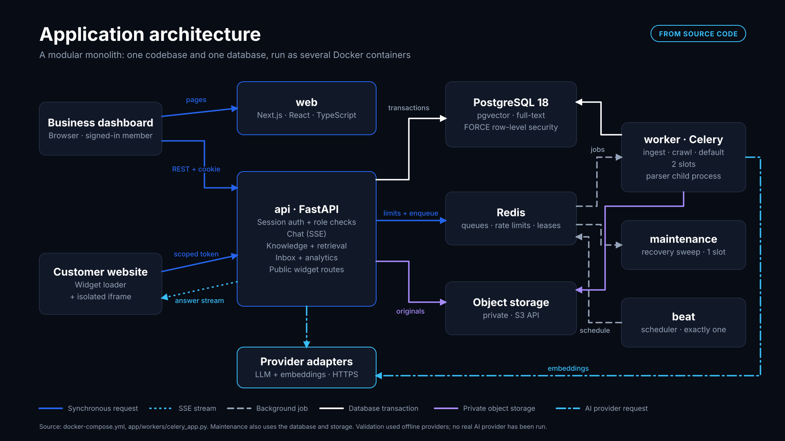

# Portfolio case study copy

Replace every `[…]` before publishing. Claims trace to [00](00_PROJECT_FACT_CHECK.md).

## Short version — project card

**Multi-Tenant AI Customer Support Platform with RAG**

Businesses create support chatbots from their own documents and websites, with each organization's
data kept apart. Next.js, FastAPI, PostgreSQL with pgvector, Redis and Celery. Seven audit
findings fixed and validated locally with 1,505 passing tests. Undergraduate portfolio project;
not a production service.

`Full-stack` · `Backend` · `RAG` · `Multi-tenancy`

## Long version — case study page

### Overview

An undergraduate engineering project: a multi-tenant platform where a business sets up a support
chatbot, gives it documents or website pages as knowledge, embeds it on its own site and reviews
the conversations. It is demonstrated by video from a local environment rather than run as a
public service.

**Watch:** [VIDEO A LINK] (80 s) · [VIDEO B LINK] (10 min)

### Problem

Support teams answer the same questions repeatedly while the answers sit in documents and web
pages. A shared platform that helps many businesses must never let one business's knowledge or
conversations reach another.

### Solution

- A dashboard for organizations, roles, chatbots, knowledge, conversations and analytics.
- Background ingestion of PDF, DOCX, TXT and website pages into searchable chunks.
- Retrieval that combines vector and keyword search, with citations limited to sources actually
  given to the model.
- An embeddable widget with its own isolated frame, scoped short-lived tokens and anonymous
  resume.

### Technology

Next.js 16, React 19, TypeScript · FastAPI, Python 3.13, SQLAlchemy, Alembic · PostgreSQL 18 with
pgvector · Redis, Celery · S3-compatible storage · Docker Compose · pytest, Vitest, Playwright.
OpenAI-compatible provider adapters (not yet run against a real provider).

### Architecture

A modular monolith: one codebase and one database, run as web, API, worker, maintenance and
scheduler processes. Requests and streamed answers stay in the API; parsing, crawling and
embedding run in background workers. PostgreSQL is the source of truth, with forced row-level
security beneath application checks.

### Engineering highlights

| Problem | Fix | Local evidence |
|---|---|---|
| Ten concurrent chats exhausted the database pool | Release connections early, bounded admission, short transactions | At 100 concurrent: 67 served, 33 refused cleanly, 0 failed |
| A source cut from the prompt could still be cited | Citations resolve only against rendered sources | Original failing test plus 32 new tests pass |
| Parsing had no time or memory limit | Fresh limited subprocess per document, fenced attempts | Real workers killed and recovered. Containment, not a sandbox |
| A stale crawl could overwrite newer stored pages | New object key per write, published by the owner | Race reproduced, then 20 of 20 tests pass |
| Installing the widget twice duplicated it | Page-wide registry, `destroy`, explicit instances | Browser journeys; loader 5,248 bytes gzip of 10,240 |

### Testing and validation

Reported local results: 1,209 backend, 17 runtime proxy, 243 web unit, 19 widget unit and 17
browser tests passed (1,505). Capacity gate 10 of 10 declared runs, tightest margin 25 ms. Fixes
were deliberately broken 10 times and tests caught each. Backup and restore rehearsed locally, and
a permissions defect it exposed was fixed. Self-audit score 80.5 → 85.75 of 100. These are not
independent certification.

### My contribution

This is my portfolio project, built with AI coding assistants including [Codex / Claude Code /
Cursor — confirm]. My part: [list only confirmed items from C1–C10: planning, requirements,
architectural decisions, prompt design, code review, debugging, testing, performance
investigation, documentation].

### Current limitations

- No real AI model or semantic embeddings have been evaluated. Offline answer-bearing Recall@5 is
  85% against a 90% target.
- Citation provenance is enforced; whether a source supports a sentence is unverified.
- Hosted CI has never run. Nothing is deployed.
- The parser is contained but not sandboxed; ingress and TLS, retention, off-site backup and
  alerting are incomplete.
- Formal closure of the stabilization milestone awaits a migration policy decision.
- Billing and messaging channels are not implemented.

### Links

- Video: [LINK]
- Repository:
  https://github.com/vranasinghe/Multi-Tenant-AI-Customer-Support-Platform-with-RAG
  — **do not publish this line yet**: the public default branch holds only the first commit
  (fact check X1).
